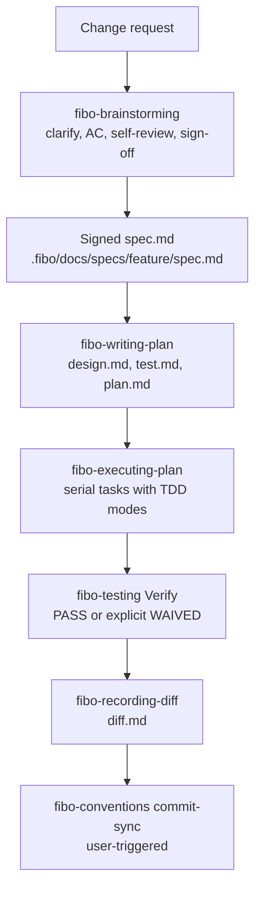

# FiboSkills

Official skills used in **FiboCode**.

FiboSkills packages the workflow skills that FiboCode and compatible AI coding agents use to run a change from intent to signed-off documentation and verified code: spec-first brainstorming, AC-driven planning, TDD execution, diff recording, and the shared conventions that keep documents, code and commits in sync.

Every skill is a self-contained agent skill package: a `SKILL.md` entry point plus the `references/`, templates and helper scripts it needs. The skills do not depend on an external project.

## Skill catalog

| Skill | What it does | When it applies |
| --- | --- | --- |
| [`fibo-brainstorming`](skills/fibo-brainstorming/SKILL.md) | Clarifies intent, writes testable EARS acceptance criteria, self-reviews the draft, and waits for explicit user sign-off before anything is written to `.fibo/docs/specs/`. | Before any change that alters externally visible behavior, AC or contracts. |
| [`fibo-writing-plan`](skills/fibo-writing-plan/SKILL.md) | Produces `design.md`, `test.md` and `plan.md` from a signed spec, enforcing 100% AC ↔ TC ↔ task coverage. Epic mode splits a large feature into sub-features. | After `spec.md` is signed and before production code is written. |
| [`fibo-testing`](skills/fibo-testing/SKILL.md) | Maintains `test.md`: AC ↔ TC mapping, test levels, TDD modes, mirrored `src` → `test` paths, canonical commands, and the final verification gate. | While shaping the plan and when verifying a finished feature. |
| [`fibo-executing-plan`](skills/fibo-executing-plan/SKILL.md) | Runs `plan.md` tasks in order using the TDD mode each task declares, allows one bounded automatic repair, and ends with the `fibo-testing` verification gate. | After `design.md`, `test.md` and `plan.md` exist. |
| [`fibo-recording-diff`](skills/fibo-recording-diff/SKILL.md) | Turns a real diff into `diff.md`: file-first reading order, hunk-level design explanation, code anchors, and Mermaid views of the affected flows. | After implementation and final verification evidence exist. |
| [`fibo-conventions`](skills/fibo-conventions/SKILL.md) | The project conventions: Markdown structure and jump tags, Mermaid rules, code naming and comments, the `.fibo/docs/` document system, reverse sync, commit sync and `.fibo/index.json` baselines. | Whenever a document or code file is written, changed or synced. |
| [`fibo-code-analysis`](skills/fibo-code-analysis/SKILL.md) | Generates structured `.fibo/analysis` mirror documents — file summaries, structure skeletons and folder summaries — using a concurrent pipeline and prompts for C, Cangjie, C++, Go, Java, JavaScript, TypeScript and Python. | To analyze a codebase, or to understand and extend Fibo's analysis pipeline. |
| [`fibo-skills-reviewer`](skills/fibo-skills-reviewer/SKILL.md) | Audits the wording of a skill package against eight defect classes (contradictions, gaps, meta-comment leaks, unclear references, redundancy drift, ...) and reports suggestions that change wording only. | When reviewing or cleaning up a skill. |

## How the skills chain

`fibo-brainstorming` starts the chain for behavior-changing work. Each later skill consumes the artifact the previous one produced, and `fibo-conventions` governs every artifact written along the way. `fibo-code-analysis` and `fibo-skills-reviewer` are standalone.



## Repository layout

```
skills/
├── fibo-brainstorming/
│   └── SKILL.md
├── fibo-code-analysis/
│   ├── SKILL.md
│   └── references/              # pipeline, template DSL, structure schema, prompts/
├── fibo-conventions/
│   ├── SKILL.md
│   ├── references/              # conventions/, templates, anti-patterns
│   └── scripts/                 # sync-helper.sh, sync-helper.ps1
├── fibo-executing-plan/
│   └── SKILL.md
├── fibo-recording-diff/
│   ├── SKILL.md
│   └── references/              # diff.template.md
├── fibo-skills-reviewer/
│   └── SKILL.md
├── fibo-testing/
│   ├── SKILL.md
│   └── references/              # test.template.md, sdd-tdd-integration-guide.md
└── fibo-writing-plan/
    ├── SKILL.md
    └── references/              # plan.template.md
```

The repository root also contains an earlier layout of these directories. It predates `skills/` and does not include `fibo-testing`; where the two disagree, `skills/` is newer. Use the `skills/` tree as the current suite.

## Using a skill

Each `SKILL.md` opens with YAML frontmatter whose `description` states when the skill applies. An agent that discovers skills by that description loads the skill on its own; you can also ask for it by name, for example "use the `fibo-writing-plan` skill".

To add the skills to an agent, copy or link the whole skill directory into the location that agent scans for skills:

```bash
mkdir -p /path/to/agent/skills
cp -R skills/fibo-brainstorming /path/to/agent/skills/
```

Keep the directory intact. `SKILL.md` refers to its companions with relative paths (`references/...`, `scripts/...`), and removing those files breaks the skill.

Skills that read or write project documents expect a `.fibo/` directory at the project root. `fibo-conventions/scripts/sync-helper.sh` finds that directory by walking upward from the current directory, and its commands require `bash` and `python3`; use `sync-helper.ps1` on Windows PowerShell.

## Project artifacts

The workflow writes everything under a single `.fibo/` directory at the project root:

| Path | Contents |
| --- | --- |
| `.fibo/docs/specs/<feature>/` | One directory per feature: `spec.md`, `design.md`, `test.md`, `plan.md`, `diff.md`. |
| `.fibo/docs/architecture/` | Cross-feature architecture and module-dependency views. |
| `.fibo/docs/decisions/` | Architecture decision records, including why the rejected options were rejected. |
| `.fibo/docs/reports/` | One-off investigation, analysis and retrospective reports. |
| `.fibo/docs/backlog/` | Deliberately deferred TODOs with value, reason and prerequisites. |
| `.fibo/docs/ideas/` | Captured ideas, persisted only when the user asks for them. |
| `.fibo/analysis/` | Code-analysis output mirroring the analyzed source tree. |
| `.fibo/index.json` | Sync baseline used by the commit-sync flow. |

## Working on a skill

- Keep the frontmatter `name` and `description` precise: the description is the trigger an agent matches against.
- Keep each package self-contained. References use relative paths that obey the repository's path rules (relative to the project root, no leading `/`, no absolute paths).
- Run `fibo-skills-reviewer` before proposing wording changes to a skill. It reports defects and suggestions but does not change rule semantics.
- Update the trailing `name` / `update-time` / `description` block whenever a Markdown document changes, as `fibo-conventions` requires.

---
name: FiboSkills README

update-time: 2026-11-03 16:35

description: Overview of the FiboSkills suite: what each Fibo skill does, how the skills chain from signed spec to verified code, repository layout, usage, and project artifacts

---
