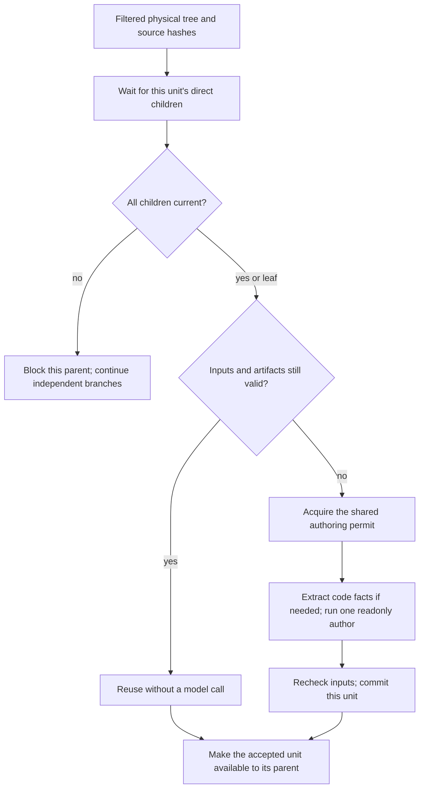
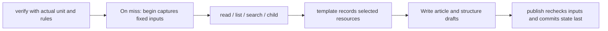

# Current analysis pipeline

Read this reference for Fibo orchestration, reuse, publication and context failures, or §6 for the standalone artifact tool. Use `template-dsl.md` for writing and `structure-schema.md` for machine facts. Resource locators are skill-relative; the bundled tool shares deterministic artifact logic with the backend without supplying its Agent/Provider runtime.

## 1. Entry, units and scheduling

`POST /api/analysis/start` calls `AnalyseService.startAnalysis()`, replaces an active task, captures a Provider profile and starts `runHierarchicalAnalysis()`. The host validates workspace-relative tree paths, applies supported-file and ignored-directory policies, excludes `.fibo`, and builds a content-hash snapshot. There is no opening model call or model-authored repository map.

| Physical object | Stable identity | Runtime level / source kind | Article layout |
| --- | --- | --- | --- |
| Code file | `file:src/a.ts` | `file` / `code` | `code` |
| Config file | `file:config/x.json` | `file` / `config` | `config` |
| Non-root directory | `collection:src/svc` | `collection` / `directory` | `directory` |
| Workspace root | `repository:.` | `repository` / `workspace` | `repository` |

The type system still accepts `module` for directory-like identities, but the current physical-tree builder creates `collection` units. Do not create virtual modules or change identities based on generated names or roles.

Leaves start independently. A directory proceeds as soon as its own direct children are current, without waiting for unrelated files. Ready files and directories share an authoring semaphore: `provider.concurrentRequests`, default `2`. Cache checks do not consume permits. Dependency order is required; a globally serial directory pass is not.

## 2. One unit's authoring session

On a code cache miss, `extractFileFacts()` obtains FileMeta without publishing files or placeholders. The host projects symbol facts with duplicated `code` and `description` fields removed. Other unit kinds do not request code facts.

One `ClassicReActAgent` uses `executionPolicy: { mode: 'natural' }`, captured Provider settings and a readonly toolbox. It explores, selects roles, reads the composed Template and returns exactly one nonempty final Markdown response. Directory input contains deterministic direct-child descriptions and accepted article hashes; a dedicated tool supplies full article ranges. There is no LLM child-compression call.

| Tool | Contract |
| --- | --- |
| `workspaceReadFile` | Read source by workspace-relative path and optional 1-based range |
| `workspaceListDirectory` | List immediate source children; `.` means root |
| `workspaceSearch` | Literal text search over an optional path, with bounded results |
| `analysisReadChildInfo` | Read a supplied current direct-child article by `unitId` and optional range |
| `analysisReadTemplate` | Supply one `primaryRole` and a `secondaryRoles` array; the host fixes the layout |

Source reads enforce realpath containment, including symlinks, and exclude `.fibo` as source evidence. Source files are limited to 2 MiB; range reads are bounded to 400 lines and about 64 KiB per result. Follow truncation with focused reads. A bounded listing/search is not an exhaustive inventory.

Missing template reads, unresolved markers and malformed presentation markup produce degradations that retain a useful nonempty article. The runtime does not compile an intermediate article, repair the full text with another model, or turn a failed/empty terminal into a successful placeholder. Diagnostics do not relax the author's obligation to follow the Template.

## 3. Exact reuse inputs

| Input | File | Directory or root |
| --- | --- | --- |
| Fixed input | Target source SHA-256 | Direct-child `{ id, infoFingerprint }` entries sorted by identity |
| Explicit rules | Prompt version/material, execution-policy version, output language, model identity/settings and run configuration | Same |
| Consumed observations | Tool-returned file contents, directory-listing results, search results and selected Template content | Same |
| Public integrity | Canonical paths, parseable runtime artifact and exact hashes of both public files | Same |

`infoFingerprint` hashes accepted `info.md` bytes, including host metadata, not semantic equivalence. A changed child article or child set can invalidate its parent. Private observations retain empty/truncated discovery results, request parameters and actual selected Template content; replay them rather than only checking files that had hits.

The current private schema uses `observedInputs` with kinds `file`, `directory-listing`, `search` and `template`; tool reads may also record the target source already represented by fixed input. Earlier `observedFiles`-only instructions are incomplete. The model does not declare a public `readSet`. Its own role, rationale, outline and prose are not fixed inputs; Template observations record the resources consumed for the selected role context.

On a hit, load the accepted pair without Provider preflight, exploration, writing or metadata refresh. A run with every unit reused yields `completionReason: up-to-date`. An existing `info.md` alone never establishes reuse.

## 4. Independent publication and failure

Each complete unit publishes three adjacent companions according to the entry table: `info.md`, schema-v2 `structure.json`, and `state.json`. State contains canonical identity, rule/input hashes, source or child inputs, observations, artifact paths and byte hashes. The backend maintains a typed TypeScript implementation; the standalone skill independently maintains its CommonJS tool. Both follow the same path, fingerprint, state-v2 and state-last publication protocol. Compatibility is checked through behavior tests, not source-file equality or automatic copying.

The old `.fibo/analysis/.state/<sha256(unitId)>.json` location is a backend compatibility input. If the new state is absent, an old state may migrate only after its identity, rules, inputs, observations and public bytes pass verification. Migration writes the new state without rewriting article/structure, then removes the old record. A corrupt new state does not fall back to an older success.

The publisher preserves prose and appends one trailing `name` / `update-time` / `description` block with blank lines between fields. The physical unit supplies `name`; the derived article description supplies `description`; the actual publication clock supplies time. Cache loading and child readers strip metadata from the article body. Do not add the retired `----------` terminator.

State-last publication provides recoverable per-unit acceptance, not a simultaneous transaction across files or units. If public files change but state commit fails, the mismatched pair is not current and must be rebuilt. Recheck source, direct-child hashes, consumed observations, cancellation and task ownership before acceptance. Authoring verification rejects changed consumed resources with `template-changed` and changed source observations with `source-changed`.

A failed child blocks ancestors; unrelated branches retain successful commits. Unit outcomes are `current`, `failed`, `cancelled` or `blocked`. A run returns `success` only when root is current, `partial` when some units succeeded without a current root, `failed` when none succeeded, or `cancelled`. Cancellation/task replacement prevents late commits and retains earlier accepted units.

Deletion/rename cleanup follows validated canonical state records; changed child identities propagate to physical ancestors. Do not sweep arbitrary workspace files or generated-looking paths.

## 5. Context and execution resilience

- A missing Provider `contextWindow` resolves at runtime to **131,072 tokens (128K)**; an explicitly invalid value fails. This does not rewrite an absent saved setting.
- Natural execution derives a smaller Provider view when estimated input reaches `contextWindow - reserveTokens` or exceeds the byte boundary. The reserve covers configured output tokens and the natural-policy reserve.
- System instructions, the current request, recent atomic segments and incomplete protocol spans stay intact. Older complete spans may become labelled historical summaries. Canonical messages remain unchanged and tool-call/result pairs stay together.
- Token estimates include messages, tool definitions and output-contract fields. A separate **2 MiB serialized UTF-8 input fuse** measures the same envelope. Tokens and bytes are different limits.
- If the smallest permitted view cannot fit, stop through the context failure path. Provider overflow recovery is bounded; it cannot reset budgets or publish unfinished results.
- Current analysis defaults cap cumulative output at **160 KiB** and the unit deadline at **900,000 ms**. Provider/tool stage deadlines are bounded by remaining unit time. Natural execution does not impose fixed model-turn, Provider-delegation, tool-attempt or article-repair counts.
- An omitted Provider `maxTokens` stays omitted; do not invent the old `8192` default. Provider-declared truncation is a failure, not a complete guide.

## 6. Standalone artifact tool

The executable locator is `scripts/analysis-artifacts.cjs` relative to the skill root. It requires Node and uses only built-in modules. For the project-local skill, run `node .codex/skills/fibo-code-analysis/scripts/analysis-artifacts.cjs --help`. Resolve the installed skill's actual path when running elsewhere.

Commands accept one JSON object on stdin and return one JSON object on stdout. In PowerShell, set `$OutputEncoding = [System.Text.UTF8Encoding]::new($false)` for the JSON pipeline, then use `Get-Content -Raw -Encoding UTF8 request.json | node .codex/skills/fibo-code-analysis/scripts/analysis-artifacts.cjs begin`, changing the command and request file as needed. Both the request file and pipe must preserve UTF-8 source text. Keep requests/drafts in temporary locations or generated `.fibo` storage so analysis does not observe its own draft edits as source changes. Execute operations on a session serially; concurrent writers are rejected.

### Begin and rule inputs

The `begin` request contains `workspaceRoot`, `unit` and `rules`. Unit has exactly `id`, `path`, `kind`, `sourceKind`, matching the runtime structure identity. Directories/root additionally require `children`, the complete direct-child ID list for the requested filtered scope. Every listed child must already have a current triplet under the same standalone rule context.

`rules` has the existing AnalysisRules shape: `prompt: { version, content }`, `executionPolicyVersion`, `language`, `model`, `runConfiguration`. Supply the actual instruction material and public model/execution settings, excluding credentials. Do not guess unavailable model settings or mark an unknown rule snapshot reusable. The tool adds its execution provenance to the fingerprint. Template choices are recorded separately when read.

### Command requests

| Command | JSON fields | Result / behavior |
| --- | --- | --- |
| `verify` | `workspaceRoot`, `unit`, `rules` | `{current:true,...}` for an accepted triplet; `{current:false,reason:...}` for missing/stale data; no model calls |
| `begin` | `workspaceRoot`, `unit`, `rules`, directory/root `children` | `sessionPath`, paths and initial source or accepted child summaries |
| `read` | `sessionPath`, `path`, optional `startLine` / `endLine` | Bounded numbered source; records the complete file hash |
| `list` | `sessionPath`, `path` | Bounded direct entries; records the returned listing |
| `search` | `sessionPath`, `query`, optional `path` / `limit` | Literal hits and truncation; records discovery plus returned file evidence |
| `child` | `sessionPath`, `unitId`, optional line range | A current direct-child article without metadata; fixed child hashes already cover it |
| `template` | `sessionPath`, `primaryRole`, `secondaryRoles` | Selected layout/rules/roles/navigation; records exact content |
| `publish` | `sessionPath`, `articlePath`, `structurePath` | Reads finished drafts, normalizes article metadata and publishes three files; computes state from real session inputs |

`sessionPath` is returned by `begin`, not invented. Temporary sessions are separate from cache artifacts and removed after successful publication. Errors return nonzero exit status and an `error` string. A cache miss from `verify` is a normal result. Failed/incomplete sessions do not certify success; restart from a fresh snapshot after source changes.

Do not edit observations, hashes or state JSON manually. Facts still require parser output or the supported source-verified extraction fallback. The standalone tool uses bundled resources; backend effective user overrides remain managed by Fibo. Matching file formats do not imply identical execution rules or automatic cross-entry cache reuse.

## 7. Implementation and spec lookup

Inspect the current production boundaries before refreshing these descriptions:

<a target="_self" href="#backend/src/analyse/analyse.service.ts?class=code" style="color: inherit; text-decoration: none;">Code: backend/src/analyse/analyse.service.ts</a>

<a target="_self" href="#backend/src/analyse/analysis-orchestrator.ts?class=code" style="color: inherit; text-decoration: none;">Code: backend/src/analyse/analysis-orchestrator.ts</a>

<a target="_self" href="#backend/src/analyse/analysis-authoring-runner.ts?class=code" style="color: inherit; text-decoration: none;">Code: backend/src/analyse/analysis-authoring-runner.ts</a>

<a target="_self" href="#backend/src/analyse/analysis-artifact-publisher.ts?class=code" style="color: inherit; text-decoration: none;">Code: backend/src/analyse/analysis-artifact-publisher.ts</a>

Within the supplied specs, `physical-tree-incremental-analysis` supersedes the original planner/generation-wide scheduler; `agent-authored-info` describes direct Markdown and host metadata; `agent-context-resilience` covers the effective context window and byte fuse. Later template configuration fixes resource selection and host-owned layout. Earlier structured-file-guide/navigation-compiler designs are not the current article terminal contract. Preserve signed requirements when proposing behavior changes; do not rewrite them merely to match implementation.

---
name: Current analysis pipeline

update-time: 2026-10-23 15:29

description: Physical-tree scheduling, consumed-input reuse, direct readonly authoring, state-last publication and context resilience in Fibo.

---
