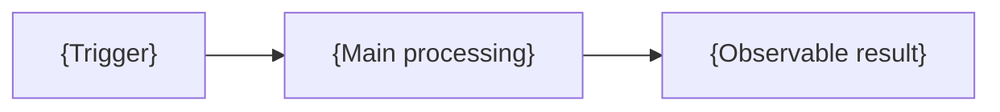

# Unit layout: code

# {Localized file name}

{Opening summary: 2–4 sentences explaining why this file exists, where it fits, and the most useful takeaway.}

## {Localized heading: Whole-unit functional diagram}

(Place this section immediately after the opening summary. Use 3–8 functional nodes, not a complete call graph.)

<tag value="graph" />

{A 1–3 sentence explanation of the main path shown above.}

## {Localized heading: At a glance}

- {Localized label: Primary role}: {Explain {{PRIMARY_ROLE}} in ordinary language.}
- [{Localized label: Secondary roles}: {Explain only useful roles from {{SECONDARY_ROLES}}.}]
- {Localized label: Confidence}: {High|Medium|Low} — {One sentence explaining what evidence supports this level.}

## {Localized heading: What this file does}

(Describe 3–6 main capabilities from a user's or new contributor's point of view.)

- {Capability and why it matters}
- {Capability and why it matters}
- {Capability and why it matters}

## {Localized heading: Key functions or classes}

(Include no more than 8 key functions or classes. Give each a one-sentence purpose. Add a code tag only when opening the definition helps.)

### `{Important symbol}`

{One-sentence purpose.}

[<tag value="code" />]

## {Localized heading: Main inputs and results}

- {Localized label: Inputs}: {Important values, events, requests, or dependencies that start useful behavior.}
- {Localized label: Results}: {Returned, emitted, displayed, stored, or otherwise observable results.}
- [{Localized label: Visible side effects}: {Only effects a user or operator can observe.}]

---
name: Code file analysis layout

update-time: 2026-10-18 19:10

description: Beginner-facing skeleton for one source-code file.

---
