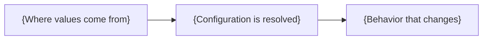

# Unit layout: config

# {Localized configuration file name}

{Opening summary: 2–4 sentences explaining what this file controls, who consumes it, and why a reader may change it.}

[## {Localized heading: Configuration flow}

(Keep this optional diagram only when it materially improves understanding.)

<tag value="graph" />

{A 1–3 sentence explanation of the flow.}
]

## {Localized heading: At a glance}

- {Localized label: Primary role}: {Explain {{PRIMARY_ROLE}} in ordinary language.}
- {Localized label: Confidence}: {High|Medium|Low} — {One evidence-based sentence.}

## {Localized heading: What it controls}

(Explain 3–6 plain-language behaviors, not parser or validator mechanics.)

- {Controlled behavior and its effect}
- {Controlled behavior and its effect}

## {Localized heading: Important settings}

(Include only settings a user or maintainer is likely to change.)

### `{Setting or group}`

{What it means, where its value comes from, and when it takes effect.}

[<tag value="code" />]

## {Localized heading: What changes when you edit it}

{Describe observable results of common changes, including restart or rebuild requirements only when verified.}

[## {Localized heading: Related documentation}

{Brief reason the document is useful.}

<tag value="text" />
]

---
name: Configuration file analysis layout

update-time: 2026-10-18 19:10

description: Beginner-facing skeleton for a configuration file.

---
