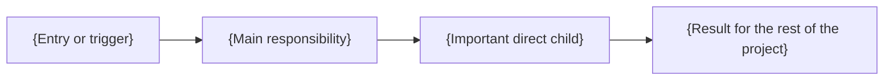

# Unit layout: directory

# {Localized directory name}

{Opening summary: 2–4 sentences explaining why this directory exists and how it helps the project.}

## {Localized heading: Whole-unit functional diagram}

(Place this section immediately after the opening summary. Show 3–8 functional nodes covering the main responsibilities and useful direct children.)

<tag value="graph" />

{A 1–3 sentence explanation of the main collaboration path.}

## {Localized heading: At a glance}

- {Localized label: Main role}: {Explain {{PRIMARY_ROLE}} in ordinary language.}
- {Localized label: Confidence}: {High|Medium|Low} — {One evidence-based sentence.}

## {Localized heading: Responsibilities and non-responsibilities}

- {Localized label: Responsible for}: {The few responsibilities that belong here.}
- {Localized label: Kept elsewhere}: {Nearby concerns this directory deliberately leaves to other areas.}

## {Localized heading: Important direct children}

(Use current direct-child info articles. Give each useful child one concise purpose statement; do not reproduce every child article.)

### `{Child name}`

{One-sentence purpose and how it contributes.}

[<tag value="text" />]

## {Localized heading: How the children work together}

{Explain the main handoff or collaboration in a short, reader-oriented path.}

## {Localized heading: Recommended starting points}

(Choose only a few entry files or subdirectories and explain why a new reader should open them first.)

1. `{Entry child}` — {Why to start here.}
2. [`{Next child}` — {Why to continue here.}]

---
name: Directory analysis layout

update-time: 2026-10-18 19:10

description: Beginner-facing skeleton for a non-root source directory.

---
