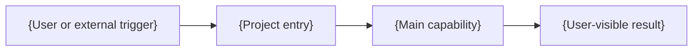

# Unit layout: repository

# {Localized project name}

{Opening summary: 2–4 sentences explaining what the project helps users do and its most important product flow.}

## {Localized heading: Whole-project functional diagram}

(Place this section immediately after the opening summary. Use 3–8 functional nodes for the product path and important top-level areas.)



<tag value="graph" />

{A 1–3 sentence explanation of the main project flow.}

## {Localized heading: At a glance}

- {Localized label: Main role}: {Explain {{PRIMARY_ROLE}} in ordinary language.}
- {Localized label: Confidence}: {High|Medium|Low} — {One evidence-based sentence.}

## {Localized heading: Getting started}

(Inspect a root README first. Summarize only the minimum useful prerequisites, installation, configuration, start or use instructions. Add a Document navigation tag beside README-derived guidance. Do not copy long README passages.)

[### {Localized heading: Prerequisites}

{Verified runtime, tool, service, or platform requirements.}
]

[### {Localized heading: Install and configure}

```text
{Verified installation or configuration command}
```
]

[### {Localized heading: Start or use}

```text
{Verified start or usage command}
```
]

[### {Localized heading: Build and test}

```text
{Verified build or test command}
```
]

[<tag value="text" />]

(If README guidance is absent or incomplete, verify only through manifests, scripts, container files, example environment files, and entry source. If the project still provides no proof, state that it could not be verified rather than guessing.)

## {Localized heading: Main areas}

### `{Top-level child}`

{One-sentence purpose based on its current info article.}

[<tag value="text" />]

## {Localized heading: How the main areas work together}

{Explain the main product flow without recreating a full dependency graph.}

## {Localized heading: Recommended starting points}

1. `{First area or file}` — {Why a new reader should begin here.}
2. [`{Second area or file}` — {Why it comes next.}]

---
name: Repository analysis layout

update-time: 2026-10-18 19:10

description: Beginner-facing root guide with verified setup and project navigation.

---
