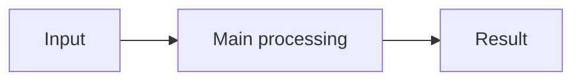

# Analysis navigation tags

Use navigation for code, documents, and diagrams that help the reader understand the current analysis unit. These rules define all three final tag formats; no additional tag-rule resource is required.

## Common requirements

- Replace `<tag value="code" />`, `<tag value="text" />`, and `<tag value="graph" />` with the corresponding complete markup below. Return finished HTML, not unresolved placeholders or IDs for a later compiler.
- Every `href` starts with `#` and includes the exact `?class=code`, `?class=text`, or `?class=graph` parameter. The document tag uses `text`, not `document`.
- Navigation targets use `/` separators and complete workspace-relative paths. Do not use absolute paths, leading `/`, `./`, guessed filenames, or paths copied from examples without evidence.
- Standalone cards display `Code: ` or `Document: ` followed by the full target, or `Graph: ` followed by `mermaid_info.name`. Compact tags omit all three prefixes: code shows the filename and any line locator, documents show the filename, and graphs show only the diagram title. Keep full navigation paths and locators in `href` and graph container IDs.
- Use either the standalone `div + span + a` form or the compact `div + a` form below, retaining that form's style attributes and `target="_self"`. Emit navigation HTML directly, outside code fences. Only Mermaid code belongs inside a `mermaid` fence.
- Substitute verified paths and source line numbers for example values. Source line numbers are 1-based. Article headings and diagram names follow the requested output language; standalone tag prefixes stay unchanged, while compact labels have no prefix.

## Standalone and compact presentation

Both forms use the same navigation protocol. Changing presentation must not change the target, class, line locator, or diagram sequence. Visible text follows the chosen presentation: the compact form uses the short labels below.

- **Standalone card**: use the existing `div + span + a` examples for dedicated template slots, links below headings, and a diagram's own navigation row. This is the default when a layout provides a separate navigation slot.
- **Compact tag**: use `div + a` for references in a sentence, a list item, a table cell, or several references shown together. Put background and text styles on the `div`; omit the `span`, border, and outer margin; retain a small `border-radius: 4px` and `padding: 0 6px` so the background extends 6px beyond the text on each side.
- Use `display: inline`, `background-color`, the matching theme foreground variable, `font-size: inherit`, and `font-weight: 500`. Keep the anchor's `color: inherit; text-decoration: none;`. Use `background-color` rather than the `background` shorthand, which the renderer filters out.
- Write each compact tag on one source line. Long filenames and titles may wrap naturally; do not truncate them or force no-wrap styling.

| Reference | Compact visible text | Example |
| --- | --- | --- |
| Whole code file | Filename | `example.ts` |
| Single code line | Filename:line | `example.ts:10` |
| Code range | Filename:start-end | `example.ts:1-33` |
| Document | Target filename, preserving its actual extension | `example.ts.info.md` |
| Graph | Diagram title from `mermaid_info.name` | `Example flow` |

Use the last `/`-separated path component as the filename; a directory-document shortcut displays the directory basename. Compact tags have no `Code: `, `Document: `, or `Graph: ` prefix. Keep the complete path and existing locator in `href`; shortening the label must never shorten the navigation target or invent line numbers.

Code example:

<a target="_self" href="#src/example.ts:10-24?class=code" style="color: inherit; text-decoration: none;">example.ts:10-24</a>

Document example:

<a target="_self" href="#src/example.ts.info.md?class=text" style="color: inherit; text-decoration: none;">example.ts.info.md</a>

Graph-reference example; apply the graph-path rules for the current analysis object:

<a target="_self" href="#src/example.ts:1?class=graph" style="color: inherit; text-decoration: none;">Example flow</a>

### Embedding and graph boundaries

A `div` directly inserted into an ordinary Markdown paragraph can split that paragraph even with `display: inline`. When a sentence or list-item paragraph must share a line with compact tags, wrap the entire paragraph in an outer `div` and use compact `div` tags inside it. Write that HTML paragraph on one source line, use HTML for any additional formatting inside it, and separate it from surrounding Markdown blocks with blank lines. A tag occupying a table cell can use the compact form directly.

Inspect 
<a target="_self" href="#src/example.ts:10-24?class=code" style="color: inherit; text-decoration: none;">example.ts:10-24</a>
; the related guide is 
<a target="_self" href="#src/example.ts.info.md?class=text" style="color: inherit; text-decoration: none;">example.ts.info.md</a>
.

The graph example above references an existing diagram. A reference alone needs no copied Mermaid block, node JSON, or new graph-container ID. When creating a new diagram, retain the Mermaid block, matching outer `div.id`, metadata JSON comment, and exactly one graph link; only the inner link wrapper may use the compact form. Compact styling never permits dropping graph metadata.

Preserve the actual presentation of tags copied from existing content, including their small rounded corners and horizontal padding. Do not expand compact tags into cards, add a missing `span`, or simplify an existing card merely while summarizing it. The required clickable element remains an `a` with the correct `href`; a styled `div` containing plain text is not a navigation tag.

The type-specific prefixed text rules and full HTML examples below describe standalone cards. For compact tags, use the short labels above instead.

## 1. Code tag: `<tag value="code" />`

Use a code tag to open a source or configuration file, a specific line, or a meaningful line range.

| Scope | `href` | Standalone visible text |
| --- | --- | --- |
| Whole file | `#{file-path}?class=code` | `Code: {file-path}` |
| Single line | `#{file-path}:{line}?class=code` | `Code: {file-path}:{line}` |
| Multiple lines | `#{file-path}:{startLine}-{endLine}?class=code` | `Code: {file-path}:{startLine}-{endLine}` |

Use a single number for a single line, such as `:45`, not `:45-45`. A range must satisfy `startLine >= 1` and `endLine >= startLine`. Omit the locator when linking the whole file; do not invent line numbers.

Complete whole-file example:

    
        <a target="_self" href="#src/example.ts?class=code" style="color: inherit; text-decoration: none;">Code: src/example.ts</a>
    

Complete line-range example; keep the same wrapper for a single-line tag:

    
        <a target="_self" href="#src/example.ts:10-24?class=code" style="color: inherit; text-decoration: none;">Code: src/example.ts:10-24</a>
    

## 2. Document tag: `<tag value="text" />`

Use a document tag to open a file or directory analysis article, a repository overview, or another relevant Markdown document.

- Format: `href="#{document-path}?class=text"`; standalone text: `Document: {document-path}`; compact text: only the target filename.
- For generated analysis articles, use the logical `.info.md` path from the table below. These logical paths are relative to `.fibo/analysis`; omit that physical storage prefix from the tag.
- The existing source-file and directory shortcuts are also supported, as in `#src/example.ts?class=text` or `#src/services?class=text`. Prefer the explicit logical `.info.md` target when writing new article links.
- For other Markdown documents, use the actual workspace-relative `.md` path, such as `docs/design.md`. Do not append `.info.md` to an ordinary document reference.
- Standalone text matches the full target after `Document: `; compact text keeps only the target filename without a prefix. Document tags do not carry a diagram sequence or source line locator.

| Analysis object | Logical document target |
| --- | --- |
| File `src/example.ts` | `src/example.ts.info.md` |
| Directory `src/services` | `src/services/services.info.md` |
| Repository root, whose unit path is `.` | `info.md` |

For any directory, the document filename repeats that directory's basename: `src/services/auth` maps to `src/services/auth/auth.info.md`.

Complete example:

    
        <a target="_self" href="#src/services/services.info.md?class=text" style="color: inherit; text-decoration: none;">Document: src/services/services.info.md</a>
    

## 3. Graph tag: `<tag value="graph" />`

Every Mermaid diagram created in the current article must have exactly one matching metadata block and graph navigation tag. Preserve the analysis convention of binding the graph to the current source file or directory.

### Graph path and sequence

| Current analysis object | Graph-reference path | First diagram target |
| --- | --- | --- |
| Code or configuration file `src/example.ts` | `src/example.ts` | `src/example.ts:1` |
| Directory `src/services` | `src/services` | `src/services:1` |
| Repository root, whose unit path is `.` | `info.md` | `info.md:1` |

- Use the current article's owner from the host-provided analysis unit. A dependency or child path used by a node does not change the graph's owner.
- Format: `href="#{graph-path}:{seq}?class=graph"`; outer container: `
`. The locator in `href` must match the outer `div.id` exactly. Standalone text is `Graph: {diagram-title}`; compact text is only `{diagram-title}`. Both use the matching `mermaid_info.name`.
- `seq` is the diagram's position among Mermaid blocks in this article, starting at `1` and increasing as `1, 2, 3...`. It restarts in each article. It is never a source line number, a node ID suffix, or a number copied from another article.
- Use the source-file or directory path for those analysis objects. Do not use a child article's `.info.md` path as the graph owner. The repository-root exception is `info.md`; do not use `.`, a display name, or a guessed README path.
- Do not include the physical `.fibo/analysis/` prefix or use `TemporaryGraph/...` for an analysis graph.
- Give `mermaid_info.name` a meaningful, non-empty title. Display it after `Graph: ` in a standalone card, or by itself in a compact tag, such as `pi-agent-core 包的整体协作流程`. Do not substitute the title for the graph path or sequence in `href` or `div.id`.

### Mermaid and metadata requirements

The complete structure is ordered as: a fenced Mermaid block, then an outer `div` containing the metadata JSON comment followed by the styled graph link. Keep this structure immediately after each diagram; do not collect all metadata at the end of the article.

When the selected layout already contains a Mermaid block, fill that block once. Replace its `<tag value="graph" />` with only the matching outer `div`, JSON comment, and graph link. Do not add a second copy of the diagram.

- Wrap all Mermaid code in a fenced block whose info string is `mermaid`.
- Use meaningful English node IDs ending in `_NNN`, with exactly three digits, starting at `_001` in each diagram and increasing by first appearance. IDs must be unique throughout the diagram, including across subgraphs. Do not use `A`, `B`, `node1`, or random suffixes.
- Quote all displayed Mermaid labels, including node, edge, and subgraph labels. Give subgraphs meaningful IDs following the same suffix convention.
- The HTML comment contains strict JSON with a `mermaid_info` object, a descriptive `name`, and a `nodes` array. Do not add JavaScript comments or trailing commas; escape quotes, backslashes, and control characters inside JSON strings.
- Include every diagram node exactly once in `nodes`. Each metadata `id` and `name` must match the corresponding Mermaid ID and displayed label exactly.
- Every node must contain `id`, `name`, `path`, `hint`, `isJumpable`, `position` with integer `startLine` and `endLine`, and `references` as an array. Use `references: []` when there are no verified references.

### Node paths and positions

| Node kind | `path` | `isJumpable` | `position` | `references` |
| --- | --- | --- | --- | --- |
| A real source file, code element, or directory | Verified workspace-relative source path | `true` | `startLine >= 1`, `endLine >= startLine` | Array, default `[]` |
| An abstract step or external actor without a project source target | Empty string `""` | `false` | `startLine: 0`, `endLine: 0` | `[]` |

For file-analysis nodes, explicitly fill the current source path when the node belongs to that file. For directory and repository diagrams, fill each node's actual file or child-directory path. The article is published directly; do not leave a jumpable node's path empty expecting later processing to fill it.

Use verified source line ranges for code elements. A whole-file or whole-directory node may use `1` to `1`; do not substitute that range for known code-element positions. Keep source line positions separate from the graph sequence. Never mark a node jumpable with an empty path or zero line numbers.

### Complete graph example

This illustrates the first graph of the file-analysis article for `src/example.ts`. Replace the sample nodes, labels, paths, and positions with evidence from the current unit.

<!-- {
  "mermaid_info": {
    "name": "Example flow",
    "nodes": [
      {
        "id": "input_001",
        "name": "Input",
        "path": "src/example.ts",
        "hint": "Where the input enters",
        "isJumpable": true,
        "position": { "startLine": 10, "endLine": 12 },
        "references": []
      },
      {
        "id": "process_002",
        "name": "Main processing",
        "path": "src/example.ts",
        "hint": "Where the main behavior is coordinated",
        "isJumpable": true,
        "position": { "startLine": 13, "endLine": 20 },
        "references": []
      },
      {
        "id": "result_003",
        "name": "Result",
        "path": "",
        "hint": "The abstract result shown to the reader",
        "isJumpable": false,
        "position": { "startLine": 0, "endLine": 0 },
        "references": []
      }
    ]
  }
} -->

    
        <a target="_self" href="#src/example.ts:1?class=graph" style="color: inherit; text-decoration: none;">Graph: Example flow</a>
    

## Final checks

- All tags have the correct class parameter and complete styled HTML. Standalone cards retain their prefixes and full-path/title labels. Compact tags have no prefix: code/document labels use the filename (with any code locator), and graph labels use only `mermaid_info.name`.
- All paths and code positions come from the current workspace or verified child analysis articles, not example text.
- Every Mermaid block has one matching JSON comment and graph link. Graph owner paths match the current article, and sequences match Mermaid order from `1`.
- Mermaid nodes and metadata match exactly; jumpable nodes have real source paths and positions, and abstract nodes use the non-jumpable form.
- Remove every template placeholder and instruction from the final article. Keep the finished Mermaid, metadata comments, and navigation tags together.

---
name: Analysis navigation Prompt

update-time: 2026-10-23 15:07

description: Standalone and compact navigation tags with stable locators, readable graph titles, and Mermaid metadata.

---
