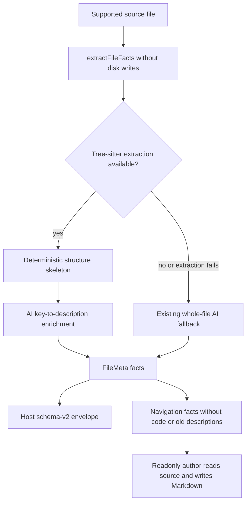

# Runtime structure artifacts and FileMeta

Read for artifact shape, code-structure extraction or language fallback. The public `structure.json` is a host-produced runtime envelope, not a bare FileMeta, model-authored evidence dossier or article plan. Resource locators are relative to this references directory.

## 1. Runtime schema v2

Complete analysis of a code, config, directory or root unit requires a structure companion in hosted and standalone use. The envelope has exactly these fields:

```json
{
  "schemaVersion": 2,
  "unit": {
    "id": "file:src/a.ts",
    "path": "src/a.ts",
    "kind": "file",
    "sourceKind": "code"
  },
  "facts": {
    "file_name": "a.ts",
    "file_path": "src/a.ts",
    "description": "",
    "file_type": "ts",
    "language": "typescript",
    "function": [],
    "classes": [],
    "global_variables": []
  }
}
```

This illustrates shape; it does not substitute for extraction from actual source.

| Object | `unit.kind` | `unit.sourceKind` | `facts` |
| --- | --- | --- | --- |
| Code | `file` | `code` | Required FileMeta with matching `file_path` |
| Config | `file` | `config` | Absent |
| Directory | `directory` | `directory` | Absent |
| Root | `repository` | `workspace` | Absent |

`unit` has exactly `id`, `path`, `kind`, `sourceKind`. Root identity is `repository:.` at `.`; directories use `collection:<path>`; files use `file:<path>`. Structure fields exclude read history, selected roles, outlines and semantic maps. The adjacent `state.json` separately uses schema version 2; structure and state are different contracts.

`createAnalysisRuntimeArtifact()` constructs this envelope in Fibo. `parseAnalysisRuntimeArtifact()` rejects identity mismatches, extra envelope fields and missing/inappropriate facts. A standalone writer follows the same shape and paths. For code, obtain FileMeta through an available extractor or the source-verified AI fallback below; do not claim model-extracted facts came from Tree-sitter. Non-code companions contain only version and unit, with no `facts`. Complete analysis additionally requires the tool-generated state companion; missing facts or any companion means incomplete analysis. Only an explicitly prose-only request may omit the triplet.

## 2. Extraction and writing are separate



Tree-sitter extracts names, kinds, types and positions deterministically. During skeleton enrichment the AI supplies descriptions only: it must not rename, add, remove or reparse elements. Missing/disabled grammars or extraction failures can use the existing whole-file AI fallback; do not claim all languages have deterministic parser coverage.

Both paths return FileMeta. Current orchestration calls non-publishing `extractFileFacts()`, not old summary-writing methods. A structure-model call is not a second article writer. The article Agent receives facts with duplicated `code` and `description` removed and must read source. Complete facts remain machine data; they are not converted into a Markdown appendix.

## 3. Description enrichment

Use `prompts/structureDescription.prompt.md`. Input provides exact addressing keys, commonly `kind:name:startLine`, including file-level keys. Return a JSON mapping such as:

```json
{
  "file:src/geo.ts:0": "Geometry operations and shared shapes",
  "function:add:7": "Adds two values",
  "class:Circle:4": "Circle representation and area calculation"
}
```

Copy supplied keys exactly; do not reconstruct keys or change their line numbers. Cover the supplied elements, use an empty description when meaning cannot be established, and return JSON only. This describes machine elements, not the guide terminal.

## 4. Nested FileMeta contract

| Group | Fields and constraints |
| --- | --- |
| Basic | `file_name`, `file_path`, `description`, `file_type`; optional `language` |
| Required arrays | `function`, `classes`, `global_variables` |
| Optional imports | `import_class`, `import_function`, `import_variable`, `import_package`, `import_module` |
| Language-dependent definitions | `interfaces`, `enums`, `structs`, `traits`, `protocols`, `constants`, `macros`, `type_aliases`, `decorators`, `annotations` |

Positions are 1-based inclusive pairs: `[startLine, endLine]`, or `[5, 5]` for one line. IDs follow extractor conventions such as `path:name` or a function signature. Import `filepath` is a resolved workspace path, `thirdparty`, or an explicitly unresolved value as supported by extraction. Derive internal paths from actual source and repository facts.

Do not infer new fields or hard-coded language exclusivity from an old prompt: Go also has `structs`, and TypeScript has `decorators`. Preserve the DTO/extractor contract, including current function `code` handling; old fallback prompts may request `null` while the TypeScript DTO declares a string. Do not synthesize code bodies or normalize that compatibility discrepancy in a skill-only update.

## 5. State companion

The three filenames share one source mapping: a file appends `.state.json`, a directory uses `<directory>/<basename>.state.json`, and root uses `.fibo/analysis/state.json`. Invoke the bundled artifact tool as documented in `pipeline.md` §6. State must be calculated, not authored by the model.

State-v2 stores the three-field physical unit identity, `rulesFingerprint`, `inputFingerprint`, either `sourceFingerprint` or sorted direct-child `children`, normalized `observedInputs`, `infoFingerprint`, the two content artifact paths and their byte hashes. The state file's own path is derived from identity, and it does not hash itself. Moving the file from the legacy hash directory does not require changing this content schema.

The tool only accepts current source/child inputs and replays consumed file, listing, search and Template observations. Different model/rule contexts or missing/tampered artifacts produce a miss. State is not a second semantic report; prose, roles and diagrams belong to the article, while code facts belong to structure.

## 6. Language fallback and maintenance

The existing AI branch selects `prompts/codeAnalysis.<language>.prompt.md`, then generic `prompts/codeAnalysis.prompt.md`, then the configuration loader's `prompts/default.prompt.md` fallback if needed. These are structure resources only. Missing/invalid current writing resources fail instead of using this generic fallback.

Adding a language prompt alone does not add discovery or parser support. Check extension mapping, supported-file policy, the `SupportedLanguage` type and grammar/extractor handling. Bundled language files are fallback resources, not an exhaustive support registry.

When changing runtime envelopes or FileMeta, inspect producers and current consumers: publication, cache loading, symbol tools and frontend/search readers. Do not restore the retired complete-symbol Markdown renderer.

Current implementation lookup:

<div style="display: flex; align-items: flex-end;"><span style="background-color: var(--tag-code-bg); margin: 8px 0 8px 14px; padding: 6px 12px; border-radius: 4px; border-left: 4px solid var(--tag-code-border); color: var(--tag-code-fg); font-size: 14px; font-weight: 500;"><a target="_self" href="#backend/src/analyse/analysis-runtime-artifact.ts?class=code" style="color: inherit; text-decoration: none;">Code: backend/src/analyse/analysis-runtime-artifact.ts</a></span></div>

<div style="display: flex; align-items: flex-end;"><span style="background-color: var(--tag-code-bg); margin: 8px 0 8px 14px; padding: 6px 12px; border-radius: 4px; border-left: 4px solid var(--tag-code-border); color: var(--tag-code-fg); font-size: 14px; font-weight: 500;"><a target="_self" href="#backend/src/utils/analysis/code-analysis-tool.ts?class=code" style="color: inherit; text-decoration: none;">Code: backend/src/utils/analysis/code-analysis-tool.ts</a></span></div>

<div style="display: flex; align-items: flex-end;"><span style="background-color: var(--tag-code-bg); margin: 8px 0 8px 14px; padding: 6px 12px; border-radius: 4px; border-left: 4px solid var(--tag-code-border); color: var(--tag-code-fg); font-size: 14px; font-weight: 500;"><a target="_self" href="#backend/src/types/filetype.dto.ts?class=code" style="color: inherit; text-decoration: none;">Code: backend/src/types/filetype.dto.ts</a></span></div>

---
name: Runtime structure artifacts and FileMeta

update-time: 2026-10-23 15:31

description: Schema-v2 host envelopes, nested code facts and separate Tree-sitter description and whole-file AI extraction contracts.

---
