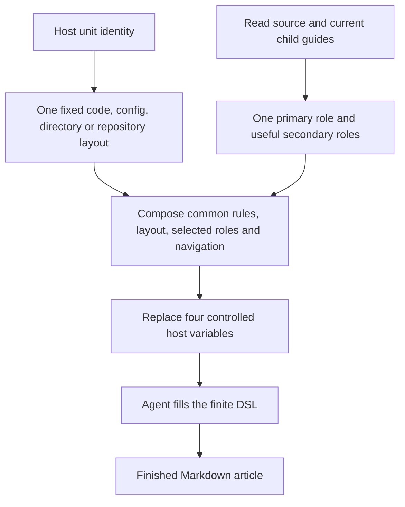

# Direct guide authoring and Template DSL

Read before authoring an `info.md` or changing writing resources. Resource locators are relative to this references directory. The article terminal is complete Markdown; JSON structure extraction is a separate contract.

## 1. Select only this unit's resources

Compose `analysisGuide` → one `analysisLayout.<type>` → primary `analysisRole.<role>` → sorted unique secondary-role fragments → `analysisNavigation`. Unselected layouts and role fragments are not sent to the Agent. Maintenance metadata and composition labels are not article sections.

In Fibo call `analysisReadTemplate` with `primaryRole` and `secondaryRoles` (`[]` when none help). The host derives the layout; do not send a model-selected `unitType`. A matching legacy value is tolerated; a conflicting value fails without a Template observation. Missing or contradictory host identity fails rather than guessing.

Standalone, determine the physical kind before role selection and use the artifact tool's `template` command inside a real `begin` session. It composes the equivalent resources, substitutes the four variables and records the content actually returned. The same session later produces and verifies state; see `pipeline.md` §6.

## 2. Roles are a reading lens

Choose from actual ownership and behavior, not merely a filename, import or incidental dependency call. The primary role states the main responsibility. Secondary roles must add distinct supported information and exclude the primary. Judge a directory/root as a whole using its contents and current child summaries rather than copying one child's role.

| Controlled role | Use when the unit owns |
| --- | --- |
| `entry` | Startup, commands, events or lifecycle entry into a flow |
| `presentation` | User-visible rendering, formatting or interaction |
| `api-boundary` | Operations exposed to callers, accepted inputs and results |
| `orchestration` | Coordination of meaningful steps, collaborators and ordering |
| `domain-rules` | Business decisions, policies and invariants |
| `data-contract` | Shared data shapes, schemas and exchanged messages |
| `state-storage` | Retained state, persistence or cache lifecycle |
| `external-adapter` | Translation between the project and an outside system |
| `infrastructure` | Shared runtime support and operating services |
| `configuration` | Settings, defaults, resolution and when effects apply |
| `extension-point` | Intentional extension contracts, registration or discovery |
| `utility` | A focused general-purpose reusable helper |
| `test-verification` | Tests, fixtures or verification harnesses |
| `generated-resource` | An artifact verified to be produced by another process |

Prefer a more specific supported role to `utility`. An exported helper alone does not establish `api-boundary`; calling storage does not establish `state-storage`; having tests does not make production code `test-verification`. Roles neither override layouts nor create units. There is no additional role/layout pairing restriction.

## 3. Finite Template syntax

| Marker | Interpreter | Handling |
| --- | --- | --- |
| `{content}` | Agent | Replace a required placeholder with verified reader content |
| A standalone `(instruction)` line | Agent | Follow it and omit the line from the article |
| `[optional content]` | Agent | Keep/fill only when supported and useful, otherwise remove the whole block, including multi-line blocks |
| `{first\|second}` | Agent | Keep the applicable choice and localize reader-facing text |
| `<tag value="code" />`, `text`, `graph` | Agent | Generate final corresponding navigation markup |
| `{{UNIT_TYPE}}`, `{{PRIMARY_ROLE}}`, `{{SECONDARY_ROLES}}`, `{{OUTPUT_LANGUAGE}}` | Host | Substitute before returning resources; use `none` for no secondary roles |

Only these double-brace variables and three tag types are supported. There are no scripts, loops or arbitrary expressions. Required text must be nonempty; unknown variables, unsupported tags and unknown resource IDs fail explicitly. Invalid custom content does not silently fall back to defaults.

Eliminate Template markers, not ordinary punctuation. Keep valid Markdown links, JSON objects, Mermaid brackets, code braces and function parentheses when they are article content. A blanket ban on `{}`, `[]`, `()` or `|` corrupts valid output.

The Agent interprets the writing markers and authors final tags. The host substitutes runtime variables; it does not compile a Template into an article or require a `{ "result": ... }` shell.

## 4. Reader-facing content

The selected layout is the article skeleton; the primary role is the main lens. Merge secondary content into the nearest section without repeating the title, overview or diagram.

| Layout | Reading focus |
| --- | --- |
| `code` | Purpose, functional diagram, role/confidence, capabilities, key symbols, main inputs and observable results |
| `config` | What it controls, role/confidence, settings, value sources and effects of edits; a useful optional diagram |
| `directory` | Purpose/diagram, role/confidence, boundaries, useful direct children, collaboration and starting points |
| `repository` | Project purpose/diagram, role/confidence, verified setup/use, top-level areas and reading order |

Follow the common rules: 2–4 opening sentences; 3–6 capabilities where requested; at most 8 key functions/classes; 3–8 functional nodes for whole-unit diagrams. For code, directories and root, put the diagram immediately after the overview and briefly explain it.

Verify root prerequisites, install/configuration, start/use, build and test steps through README first. Fill gaps from manifests, scripts, container files, environment examples and entry source. Quote commands as documentation; analysis does not execute them. State missing evidence rather than inventing versions, ports, commands or settings.

Use the resolved language for titles, headings, prose, diagram names, node/edge labels, hints and explanations. Preserve paths, identifiers, metadata keys and protocol prefixes. Standalone, use the requested language or the triggering request's language when unspecified.

Do not add evidence inventories, exhaustive failure paths, implementation minutiae, test-gap audits or refactoring advice by default. Include details only when they explain purpose, accepted input, visible behavior or results. Confidence and claims must reflect inspected evidence.

## 5. Navigation and metadata

Read `prompts/analysisNavigation.prompt.md` when emitting tags. Its analysis-specific target, label and presentation rules cover both standalone and compact forms; apply available `fibo-conventions` rules to other Markdown requirements. Keep real workspace-relative targets in `href`, required `?class=code|text|graph`, semantic `_NNN` IDs, matching Mermaid metadata and valid source positions. Abstract non-jumpable nodes have empty paths and zero positions. Do not invent unread line references or force all directory nodes to line `1`.

Standalone cards show prefixed full-path code/document labels or `Graph: {diagram-title}`. Compact inline tags show only the filename with any code locator, the document filename, or the diagram title; they have no type prefix. Use the compact `div + a` styling defined in the navigation Prompt, including theme background/foreground, 4px rounded corners and 6px horizontal padding. The short label does not replace the full `href` target.

Analysis document links use logical article paths without the physical `.fibo/analysis/` prefix: `src/a.ts.info.md`, `src/svc/svc.info.md`, and `info.md` for root. Graph targets bind to the current source file or directory plus its 1-based diagram sequence; the repository-root graph uses `info.md:{seq}`. Diagram sequences are not source line numbers. The entry table describes physical storage. Follow the bundled navigation Prompt for complete markup; author final navigation/Mermaid directly, without reference IDs for a later compiler.

The backend publisher and standalone artifact tool own the unique trailing metadata block; the model need not supply time. `name` is the physical unit name, `update-time` is actual publication time in `YYYY-MM-DD HH:mm`, and `description` is derived from the article's prose. Keep one blank line after each field. Do not copy resource-maintenance blocks or add the old terminator. For complete standalone analysis, pass finished article/structure drafts to `publish`: it normalizes metadata and computes the adjacent state file. Any missing companion means incomplete analysis; never fill the gap with model-authored state JSON.

Presentation defects produce diagnostics without a second writing pass. Runtime tolerance does not authorize leaving placeholders or omitting required sections.

## 6. Effective runtime resources

This skill bundles built-ins; effective runtime user overrides take priority in Fibo. The closed backend catalogue has 20 resources: two common Prompts, four layouts and 14 role Templates. The frontend editor exposes the 18 layouts/roles. Overrides persist under `prompts.analysisResourceOverrides` in existing global configuration.

Saving/resetting clears the affected reading-cache key; new units see effective content without restart. Existing units keep their snapshot and reject acceptance if consumed resources change. Only the actual composed Template bytes are observed: unused role changes do not alone invalidate unrelated units. Saving resources does not start analysis or immediately rewrite articles.

Direct edits to built-in files require backend restart or explicit cache invalidation. Updating the skill bundle does not update runtime defaults or user overrides.

Current implementation lookup:

<a target="_self" href="#backend/src/analyse/analysis-template-catalog.ts?class=code" style="color: inherit; text-decoration: none;">Code: backend/src/analyse/analysis-template-catalog.ts</a>

<a target="_self" href="#backend/src/analyse/analysis-readonly-toolbox.ts?class=code" style="color: inherit; text-decoration: none;">Code: backend/src/analyse/analysis-readonly-toolbox.ts</a>

---
name: Direct guide authoring and Template DSL

update-time: 2026-10-23 15:29

description: Host-fixed layouts, evidence-based roles, finite Template interpretation and effective resources for direct Markdown guides.

---
