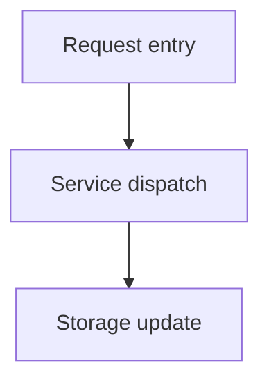

# Report reference-tag prompt (tagRule)

> This prompt is used to generate the investigation reports, research reports, codebase analysis reports, audit reports, performance reports, and retrospective reports under `.fibo/docs/reports/`.
> The report body has no fixed template; the AI should organize the content freely per the user's question; but wherever code logic, flow-diagram logic, code references, or document references are involved, this prompt must be obeyed.

## Conditions of use

- When referencing a code file, function, class, or line range, a code tag must be generated.
- When referencing a `.md` document, `.info.md`, `.document.md`, or an existing analysis document, a document tag must be generated.
- When adding a Mermaid architecture diagram, call-chain diagram, flowchart, state diagram, or sequence diagram in a report, a graph tag must be generated, preserving the Mermaid code block, node JSON comment, and graph tag in full.

## Multi-file report archiving rules

- When one investigation produces only 1 report, write it directly to `.fibo/docs/reports/{YYYY-MM-DD}-{topic}.md` (date prefix + topic, `{topic}-{YYYYMM}.md` is forbidden).
- When one investigation produces ≥ 2 reports, you must first create a `.fibo/docs/reports/{investigation-name}/` subdirectory (directory name without date), then place all report files in it.
- A multi-file report directory must contain a `README.md`, used to collect and summarize all report files produced by this investigation: explain the directory's purpose, list the files, and write a one-line summary for each; when adding a report later, this README must be updated in sync.

## Unified path rules

- Code and ordinary document targets must be relative to the project root, not starting with `/`. For generated analysis articles, use the logical document targets from `fibo-code-analysis/references/prompts/analysisNavigation.prompt.md`, omitting their physical `.fibo/analysis/` storage prefix.
- Absolute paths are forbidden, e.g. `C:/...`, `D:/...`.
- Standalone code/document cards display the full target with `Code: ` / `Document: `. Compact tags display only the filename and any code line locator, without a prefix. Graph tags display the diagram title as specified below. Keep complete navigation paths and locators in `href` and graph container IDs.
- All `href` must start with `#`, and carry `?class=code`, `?class=text`, or `?class=graph`.

## Standalone and compact presentation

Read `conventions/markdown.md` §2.1 for the shared presentation, styling, and paragraph-embedding rules for all three tag types. Use standalone `div + span + a` cards for separate navigation rows or dedicated template slots, and compact `div + a` tags for references in sentences, list items, table cells, or several references shown together. Keep full targets unchanged when switching presentation.

Compact code labels contain the filename plus any existing line locator; compact document labels contain the target filename with its actual extension; compact graph labels contain only `mermaid_info.name`. None has a type prefix. For example:

<div style="display: inline; padding: 0 6px; border-radius: 4px; background-color: var(--tag-code-bg); color: var(--tag-code-fg); font-size: inherit; font-weight: 500;"><a target="_self" href="#src/example.ts:10-24?class=code" style="color: inherit; text-decoration: none;">example.ts:10-24</a></div>

<div style="display: inline; padding: 0 6px; border-radius: 4px; background-color: var(--tag-text-bg); color: var(--tag-text-fg); font-size: inherit; font-weight: 500;"><a target="_self" href="#.fibo/docs/specs/example/spec.md?class=text" style="color: inherit; text-decoration: none;">spec.md</a></div>

The code/document templates below illustrate standalone cards. Emit finished navigation HTML outside code fences, using verified paths and source positions instead of example values. Preserve the chosen presentation when copying existing tags.

## code tag

Whole-file reference:

```html
<div style="display: flex; align-items: flex-end;">
    <span style="background-color: var(--tag-code-bg); margin: 8px 0 8px 14px; padding: 6px 12px; border-radius: 4px; border-left: 4px solid var(--tag-code-border); color: var(--tag-code-fg); font-size: 14px; font-weight: 500;">
        <a target="_self" href="#{relative-path}?class=code" style="color: inherit; text-decoration: none;">
            Code: {relative-path}
        </a>
    </span>
</div>
```

Line-number reference:

```html
<div style="display: flex; align-items: flex-end;">
    <span style="background-color: var(--tag-code-bg); margin: 8px 0 8px 14px; padding: 6px 12px; border-radius: 4px; border-left: 4px solid var(--tag-code-border); color: var(--tag-code-fg); font-size: 14px; font-weight: 500;">
        <a target="_self" href="#{relative-path}:{startLine}-{endLine}?class=code" style="color: inherit; text-decoration: none;">
            Code: {relative-path}:{startLine}-{endLine}
        </a>
    </span>
</div>
```

A single-line reference uses `:{line}`, do not write it as `:{line}-{line}`.

## document tag

```html
<div style="display: flex; align-items: flex-end;">
    <span style="background-color: var(--tag-text-bg); margin: 8px 0 8px 14px; padding: 6px 12px; border-radius: 4px; border-left: 4px solid var(--tag-text-border); color: var(--tag-text-fg); font-size: 14px; font-weight: 500;">
        <a target="_self" href="#{relative-md-path}?class=text" style="color: inherit; text-decoration: none;">
            Document: {relative-md-path}
        </a>
    </span>
</div>
```

Constraints:

- `relative-md-path` must end with `.md`; `.info.md` and `.document.md` are allowed.
- A standalone card displays `Document: {relative-md-path}`; keep this standard English prefix. A compact tag displays only the target filename without a prefix.

## graph tag

### Display name and styling

- Use the corresponding `mermaid_info.name` as the diagram title. It must be meaningful, non-empty, and in the requested output language.
- A standalone card displays `Graph: {diagram-title}`. A compact tag displays only `{diagram-title}`, without the `Graph: ` prefix. Do not display the reference path, diagram sequence, or container ID in place of the title.
- Keep the full scene-specific reference in `href` and the matching outer `div.id`. Changing the visible title or presentation must not change either locator.
- Use `background-color: var(--tag-graph-bg)` and `color: var(--tag-graph-fg)` on the styled container. Standalone cards also use `--tag-graph-border`. Keep the anchor's `color: inherit; text-decoration: none;`. Do not use the `background` shorthand, which the renderer filters out.
- Emit finished navigation HTML directly in the report, outside code fences; the HTML fences in the code/document templates only illustrate their markup.

### Report reference path

When adding a Mermaid diagram in a report, the graph's real path must bind to **the current report file that carries this diagram**:

- Single-file report: `.fibo/docs/reports/{YYYY-MM-DD}-{topic}.md:{seq}`
- Multi-file report: `.fibo/docs/reports/{investigation-name}/{file-name}.md:{seq}`
- `seq` is the occurrence order of the graph tag within that report file, incrementing from `1`.

Program-generated analysis artifacts such as `.info.md` can be generated per the real source-file / directory path rule of the corresponding analysis stage, but they too must be a real relative path; `TemporaryGraph/...` is forbidden.

The full structure must be three segments, in an immutable order:



<div id=".fibo/docs/reports/{YYYY-MM-DD}-{topic}.md:1">
<!-- {
    "mermaid_info": {
        "name": "Codebase key flow",
        "nodes": [
            {
                "id": "request_entry_001",
                "name": "Request entry",
                "path": "backend/src/agents/memory/memory.service.ts",
                "hint": "Build the model context and inject codebase info",
                "isJumpable": true,
                "position": { "startLine": 152, "endLine": 173 },
                "references": []
            },
            {
                "id": "service_dispatch_002",
                "name": "Service dispatch",
                "path": "",
                "hint": "An abstract flow node in the report",
                "isJumpable": false,
                "position": { "startLine": 0, "endLine": 0 },
                "references": []
            },
            {
                "id": "storage_update_003",
                "name": "Storage update",
                "path": "backend/src/agents/memory/memory.service.ts",
                "hint": "Update the codebase-info storage",
                "isJumpable": true,
                "position": { "startLine": 379, "endLine": 383 },
                "references": []
            }
        ]
    }
} -->
<div style="display: flex; align-items: flex-end; margin-top: 12px;">
    <span style="background-color: var(--tag-graph-bg); margin: 8px 0 8px 14px; padding: 6px 12px; border-radius: 4px; border-left: 4px solid var(--tag-graph-border); color: var(--tag-graph-fg); font-size: 14px; font-weight: 500;">
        <a target="_self" href="#.fibo/docs/reports/{YYYY-MM-DD}-{topic}.md:1?class=graph" style="color: inherit; text-decoration: none;">
            Graph: Codebase key flow
        </a>
    </span>
</div>
</div>

### Compact graph presentation

Use the shared compact presentation from `conventions/markdown.md` §2.1 for graph references in a sentence, list item, table cell, or several references shown together. The compact graph label is only the diagram title.

For the diagram above, the compact link is:

<div style="display: inline; padding: 0 6px; border-radius: 4px; background-color: var(--tag-graph-bg); color: var(--tag-graph-fg); font-size: inherit; font-weight: 500;"><a target="_self" href="#.fibo/docs/reports/{YYYY-MM-DD}-{topic}.md:1?class=graph" style="color: inherit; text-decoration: none;">Codebase key flow</a></div>

When creating a diagram, replace only its inner standalone link wrapper with the compact form; retain the Mermaid block, outer `div.id`, metadata JSON comment, and exactly one graph link. A reference to an existing diagram needs only the link, without duplicating the diagram or metadata. To keep a sentence or list-item paragraph continuous with a compact tag, wrap the whole paragraph in an outer `div`, write the complete HTML paragraph on one source line, use HTML for other formatting inside it, and separate it from surrounding Markdown with blank lines. A tag occupying a table cell can use the compact form directly.

## Mermaid and node-JSON rules

- Mermaid code must be wrapped in a fenced code block whose info string is `mermaid`.
- The node ID format is `{semantic_name}_{NNN}`, each diagram numbering independently from `_001` in order of first appearance.
- Node labels must be wrapped in quotes, e.g. `request_entry_001["Request entry"]`.
- The JSON `id` and `name` must match the Mermaid node character-for-character.
- A JSON node must contain `id`, `name`, `path`, `hint`, `isJumpable`, `position`, `references`.
- When `isJumpable=true`, `path` must be a legal relative path, `position.startLine >= 1`, `position.endLine >= startLine`.
- When `isJumpable=false`, `path` must be an empty string, `position.startLine = 0`, `position.endLine = 0`.

## Error examples

- `href="#TemporaryGraph/repo-flow:1?class=graph"`
- `Graph: repo-flow:1`
- Standalone text `Code: memory.service.ts` when the target is `backend/src/agents/memory/memory.service.ts` (missing the full path)
- Compact text `Code: memory.service.ts` (compact labels omit prefixes)
- Shortening `href` to `#memory.service.ts?class=code` merely because the compact label is `memory.service.ts`
- `href="#backend/src/agents/memory/memory.service.ts"`
- `href="#C:/Users/13909/Desktop/Fibo/backend/src/agents/memory/memory.service.ts?class=code"`

---
name: Report reference-tag prompt (tagRule)

update-time: 2026-11-01 11:27

description: Report reference tags with shared standalone and compact code/document/graph presentation, report-file locators, and single-file or multi-file report archiving rules

---
