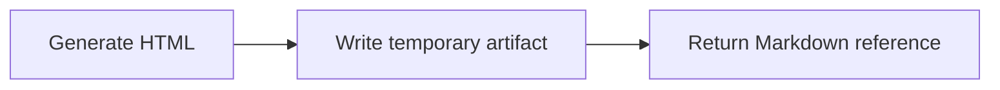

# Fibo Chat HTML

Generate a complete HTML document, run the bundled script to write it to the system temporary directory, and insert the returned Markdown into the conversation unchanged. Requires local filesystem access and Node.js 18+. The script uses only built-in modules, with no npm dependencies; all agents use the same file protocol.

## Content Guidelines

- Use only for interactive explanations, charts, visualizations, and lightweight demos in Fibo chat. Use when the user explicitly requests HTML or an interactive presentation, or when a complex topic or repeated follow-up questions call for a visual explanation. Use text, tables, or code blocks for simple content.
- Organize the content around the user's question and write in the user's language. Interactions should aid understanding, such as selecting steps, filtering data, expanding details, or adjusting parameters.
- When explaining code, call relationships, or implementation behavior, read the actual source first and distinguish confirmed facts from inferences. Add source navigation beside key conclusions, diagram nodes, or behavior descriptions. Do not invent source citations for non-code topics.
- Provide a meaningful `<title>` and pass the same readable text as `--title`. Keep the layout readable in both the small preview and expanded view, with scrolling for long content. Build diagrams directly with native HTML, SVG, or canvas; do not assume Markdown or Mermaid text will render automatically inside the page.

## HTML Runtime Constraints

- Provide complete UTF-8 HTML, at most 5 MiB, with no NUL bytes. Inline CSS, JavaScript, and data. Display code and text using escaping or `textContent`; escape `<` in embedded JSON so `</script>` cannot truncate the script.
- Do not depend on external scripts, stylesheets, fonts, adjacent local files, fetch/XHR/WebSocket, iframes, popups, form submissions, or host APIs. Fibo uses an `allow-scripts` sandbox.
- Prefer embedded `data:` images; HTTP/HTTPS images are also supported. Use `data:` for fonts and `data:` or page-generated `blob:` URLs for audio/video. The script validates UTF-8, size, and file ownership; it does not execute HTML or inspect dependencies and interactions. Ensure generated content meets these constraints.

## Source Navigation

Use verified, complete project-relative paths without a leading `/`. Line numbers are 1-based: `:12` for one line or `:12-24` for a range. These examples demonstrate syntax only; replace the paths and line numbers with actual source locations:

```html
<a href="#src/main.ts:12-24?class=code">View implementation</a>
<button onclick="location.hash='#src/main.ts:12-24?class=code'">View implementation</button>
```

Links, buttons, diagram nodes, and other clickable elements can navigate to source. Use `location.hash` without accessing the host DOM. The page hash drives host navigation: use `scrollIntoView` for scrolling within the page and local state for steps or tabs, so ordinary `#section` anchors do not trigger invalid global navigation.

For paths containing spaces, Unicode, `#`, `%`, `?`, or other special characters, encode the entire native JSON navigation intent once to keep path characters distinct from navigation delimiters:

```javascript
const sourceHash = '#' + encodeURIComponent(JSON.stringify({
  type: 'editor',
  options: { position: 'src/entry #%.ts:12-24' }
}));
document.querySelector('[data-source-link]').href = sourceHash;
// A button or another element can set location.hash = sourceHash in its click handler.
```

The JSON `position` contains the actual path and line numbers without prior URL encoding. For additional source citations in the answer body, retain the complete path, line numbers, and `?class=code`. Use the project's compact code tag when appropriate:

```html
<div style="display: inline; padding: 0 6px; border-radius: 4px; background-color: var(--tag-code-bg); color: var(--tag-code-fg); font-size: inherit; font-weight: 500;"><a target="_self" href="#src/main.ts:12-24?class=code" style="color: inherit; text-decoration: none;">main.ts:12-24</a></div>
```

## Write the Artifact and Return Its Reference



<div id=".codex/skills/fibo-html-artifacts/SKILL.md:1">
<!-- {"mermaid_info":{"name":"HTML Artifact and Reference","nodes":[
{"id":"html_source_001","name":"Generate HTML","path":"","hint":"Generate the complete page source","isJumpable":false,"position":{"startLine":0,"endLine":0},"references":[]},
{"id":"persist_html_002","name":"Write temporary artifact","path":".codex/skills/fibo-html-artifacts/scripts/html_artifact.mjs","hint":"Create the HTML and ownership files","isJumpable":true,"position":{"startLine":108,"endLine":108},"references":[]},
{"id":"markdown_output_003","name":"Return Markdown reference","path":"","hint":"Insert the reference into the answer unchanged","isJumpable":false,"position":{"startLine":0,"endLine":0},"references":[]}
]}} -->
<div style="display: flex; align-items: flex-end; margin-top: 12px;"><span style="background-color: var(--tag-graph-bg); margin: 8px 0 8px 14px; padding: 6px 12px; border-radius: 4px; border-left: 4px solid var(--tag-graph-border); color: var(--tag-graph-fg); font-size: 14px; font-weight: 500;"><a target="_self" href="#.codex/skills/fibo-html-artifacts/SKILL.md:1?class=graph" style="color: inherit; text-decoration: none;">Graph: HTML Artifact and Reference</a></span></div>
</div>

Resolve `scripts/html_artifact.mjs` relative to the directory containing this `SKILL.md`. Set `--workspace-root` to the absolute root of the current conversation's project. Neither the skill installation directory nor the shell's working directory is necessarily the project root.

This example runs from the project root with the skill in its default project location. For other installations, use the actual script path:

```bash
HTML_ARTIFACT_SCRIPT=".codex/skills/fibo-html-artifacts/scripts/html_artifact.mjs"
node "$HTML_ARTIFACT_SCRIPT" --workspace-root "$PWD" --title "Interactive Counter" <<'HTML'
<!doctype html>
<html lang="en">
<head><meta charset="utf-8"><meta name="viewport" content="width=device-width,initial-scale=1"><title>Interactive Counter</title></head>
<body><button onclick="this.textContent=Number(this.textContent)+1">0</button></body>
</html>
HTML
```

Generate the actual HTML for the user's task. A quoted heredoc preserves backticks, dollar signs, and line breaks in the source. For an existing file, use `--input page.html`; otherwise the script reads stdin. `--title` is required: pass the readable title, not HTML entity text. The caller supplies the title; the script does not parse the page.

On success, stdout contains exactly one final reference in this format. The example path only illustrates the syntax; use the script's actual output in the answer:

```markdown

```

Insert stdout **unchanged into the answer body**, optionally with a short explanation. Use the `` media syntax without a code fence, conversion to a regular link, or additional escaping. Show the HTML source only when the user requests it. On failure, the script exits with a nonzero status, writes the reason to stderr, and emits no preview reference to stdout. Correct the input before retrying; never invent a path or reference without a real artifact.

The script preserves the original HTML bytes, allocates a random numeric filename, and creates a matching `<digits>.owner.json`. The ownership file records the canonical project root's SHA-256 `workspaceHash` and the `title`, as required for Fibo to read the temporary artifact. The script handles path encoding, title escaping, and ownership metadata.

---
name: Fibo Chat HTML Artifact and Reference Skill

update-time: 2026-11-10 10:45

description: Guide HTML content, source navigation, and Markdown output, using Node.js to write temporary artifacts

---
