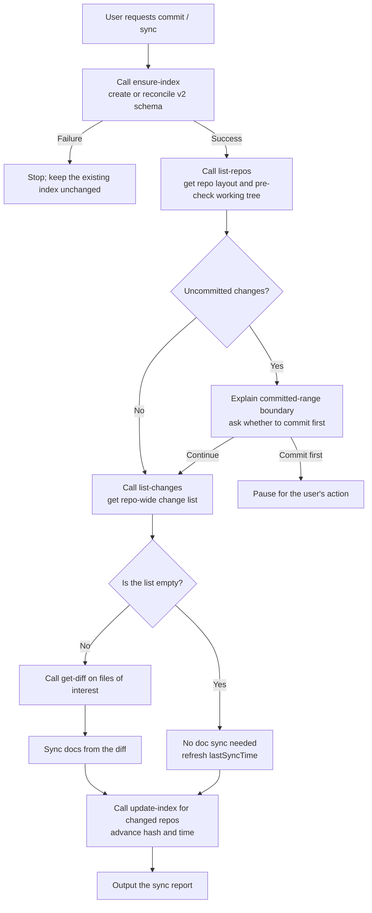
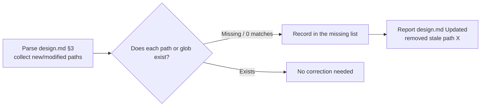
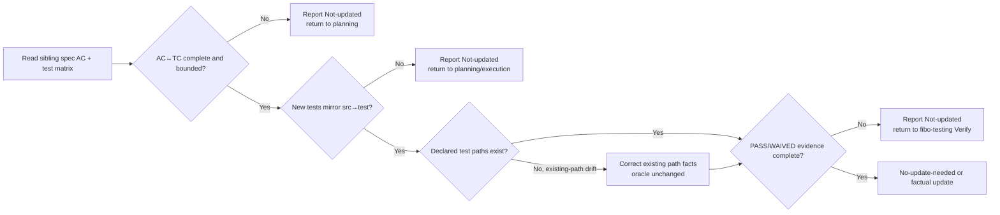

# Batch doc sync when the user requests a commit or an explicit sync (rules)

> This file is part of the `fibo-conventions` skill. **This flow triggers only when the user explicitly requests a commit or a sync**; all other scenarios go through the regular reverse sync in `sync.md`.
> For the cross-OS command to obtain system time see `sync.md` §2.3. For the code / document jump-tag format see `markdown.md`.
> The sync helper commands and `.fibo/index.json` v2 schema are defined by this document; no project-local spec is required.

> Distribution note: this skill is self-contained.
>
> - §2 defines invocation order and failure boundaries.
> - §3 defines the v2 schema.
> - §4 defines helper commands and exit codes.
>
> No repository-specific spec is assumed to ship alongside it.

## 1. Trigger conditions (strictly tightened)

| Example trigger phrasing | Behavior |
| --- | --- |
| "sync the docs", "sync docs", "align the docs", "align the docs with the code", "update the doc anchors", "commit for me", "/commit", "commit it" | Go through this flow |

**Two core constraints**:
1. **The AI does no git writes**: this flow does **not** run `git add` / `git commit` / `git push`. Whether to commit is the user's own decision.
2. **The baseline source is committed code**: the script reads the `lastSyncHash..HEAD` range. Uncommitted changes in the working tree do **not** participate in this analysis; if the user wants uncommitted changes to be synced too, remind them to commit first.

**Cases that do not trigger**: the user just changed code without saying sync; the user asks "what's the status"; the user is writing docs; the AI proactively wants to "do it while at it" — none of these trigger.

---

## 2. Core sequence



---

## 3. `.fibo/index.json` — v2 schema

Fixed schema:

```json
{
  "schemaVersion": 2,
  "repos": [
    { "path": ".", "lastSyncHash": "", "lastSyncTime": "" }
  ]
}
```

Field constraints:
- **`schemaVersion`**: fixed as `2`. v1 is **not** auto-migrated; the user must manually delete `.fibo/index.json` and re-initialize.
- **`repos[]`**: all git repos under the project (including the root repo and nested sub-repos). Created or reconciled by `ensure-index` at the start of explicit sync; when there is currently no repo, `repos: []`.
- **`repos[].path`**: the relative path to the repo root (= the parent directory of `.fibo/`); the root repo itself is written as `"."`. Does not start with `/` or a drive letter.
- **`repos[].lastSyncHash`**: the full 40-char SHA of the latest commit **already analyzed** in the last sync; empty string initially.
- **`repos[].lastSyncTime`**: the local time the last sync completed, in the format `YYYY-MM-DD HH:mm`; empty string initially.
- The file lives at `.fibo/index.json` (in the `.fibo/` root, **not** `.fibo/docs/`).

---

## 4. Mandatory script invocation (no longer assembling git commands directly)

**The AI no longer assembles `git status` / `git diff` / `git log` / `git show` itself**. All sync baseline queries go uniformly through the script `<skill-root>/scripts/sync-helper.{sh,ps1}`.

### 4.1 Locate the script path

| Platform | Path |
| --- | --- |
| POSIX (macOS / Linux / Git Bash) | `<skill-root>/scripts/sync-helper.sh` |
| Windows (native PowerShell) | `<skill-root>/scripts/sync-helper.ps1` |

`<skill-root>` = the absolute path of the directory where this skill `fibo-conventions` resides. Each agent (Claude Code / Codex / OpenCode etc.) locates its own skill root per its own convention.

### 4.2 Subcommand list

| Subcommand | Arguments | Output (stdout) | Failure exit code |
| --- | --- | --- | --- |
| `ensure-index` | none | none; creates a missing v2 schema or reconciles repo layout while preserving existing baselines | 2 / 5 / 8 |
| `list-repos` | none | JSON array: `[{ "path": ".", "hasUncommittedChanges": false }, ...]` | 5 (schema mismatch) |
| `list-changes` | none | JSON array: `[{ "repo": ".", "file": "src/foo.ts", "status": "M" }, ...]`; automatically filters common binary extensions | 5 |
| `get-diff` | `--repo <path> --file <relpath>` | Single-file unified diff; when the file is not in the change list, outputs empty and exits 0 | 3 / 6 / 7 |
| `update-index` | `--repo <path> --hash <40SHA>` | none (only writes `.fibo/index.json`) | 3 / 4 / 6 / 7 |

### 4.3 Common exit codes

| Code | Meaning |
| --- | --- |
| 0 | Success |
| 1 | Usage error (missing subcommand / unknown subcommand) |
| 2 | Cannot find the `.fibo/` directory (not inside a Fibo project) |
| 3 | An argument hit the dangerous-character blacklist or is an absolute path |
| 4 | Illegal hash format (not 40 hex chars) |
| 5 | An existing `.fibo/index.json` is unreadable or not v2 schema |
| 6 | Unknown flag |
| 7 | The path pointed to by `--repo` is not in `repos[]` |
| 8 | `ensure-index` could not write `.fibo/index.json` |

### 4.4 Invocation constraints

- ✅ **Must**: invoke all subcommands through the script itself, arguments filtered by the script's internal blacklist
- ✅ **Must**: invoke `ensure-index` once at the start of every explicit sync and continue only after it succeeds
- ❌ **Forbidden**: bypassing the script to call `git diff` / `git log` / `git show` directly
- ❌ **Forbidden**: chaining multiple subcommands into one shell pipeline passed to the shell (the script itself is the unified entry)
- ❌ **Forbidden**: letting `ensure-index` read source-file contents or write any working-tree file other than `.fibo/index.json`; it may inspect directory entries and `.git` marker existence only to discover repositories

---

## 5. Candidate MD retrieval rules

After `list-changes` gives the change-file list, you need to find "MD that mention these files" within the repo as candidate sync targets.

- **Scope**: **repo-wide `**/*.md`** (including `README.md`, `CHANGELOG.md`, `.fibo/docs/`, and MD anywhere else)
- **Exclude**: `.git/`, `node_modules/`, `dist/`, `build/`, `out/`, `coverage/`, other vendored directories
- **Hit condition**: the relative-path string of a change file appears **anywhere** in the MD file content
  - Including: paths in `href`, prose references, directory listings, paths in comments
- **Sort by hit count**: MD mentioned by multiple change files is processed first
- **Retrieval means**: use the current agent platform's "repo-wide content search" capability (e.g. ripgrep / a built-in grep tool); the script itself is not responsible for this step

---

## 6. Doc-update boundaries (removing the vague term "business-rule conflict")

| Situation | Example | Handling |
| --- | --- | --- |
| **Implementation-detail drift** | Line-number anchor moved, interface/test-file name changed, file renamed, a deleted symbol still referenced, runner command changed | Update paths, names, commands, and anchors from current code/config facts |
| **New-test layout violation** | A test marked `new` targets `src/a/c` but was created under `tests/`, beside the source, or outside `test/a/c` | Report contract error and return to planning/execution; do not normalize test.md to the wrong repository path |
| **Signed behavior or test oracle differs from code** | AC/TC expects 30s but implementation returns 60s; negative case is not enforced | Treat as implementation nonconformance; stop routine sync and route to repair, or obtain a new brainstorming sign-off if the behavior change is intentional |
| **Test evidence differs from claims** | test.md says PASS without a real run; latest run is FAIL/flaky; waiver has no explicit approval | Real execution wins; correct the evidence/status, never the oracle, and do not claim completion |
| **Implementation explanation is stale** | A call chain explained by design/diff has been replaced, while intended behavior is unchanged | Update factual description from code/real diff; keep obsolete implementation-detail history marked `stale, for reference only` where useful |
| **Code facts unclear / suspected bug** | Multi-branch behavior cannot be confirmed; implementation looks like it breaks the critical path; tests and code facts contradict each other | **Stop and report to the user**; do not use doc sync to paper over an uncertain implementation |
| **Report-type docs** (`reports/`) | Investigation / audit / retrospective snapshots | **Do not participate in this sync** (snapshot nature, per `docs-system.md` §2) |
| **Unrelated beautification** | Adjusting the layout of an unrelated section / fixing grammar | **Forbidden** to change while at it |

> 📌 `.fibo/docs/specs/**/{spec,design,test,plan,diff}.md` form the **living-contract quintet**. `design.md` triggers §9, `test.md` triggers §10, and `diff.md` is refreshed only from a real diff after final PASS or explicit WAIVED evidence.

---

## 7. Update `index.json` and the sync report

### 7.1 Update rules

- At sync start, `ensure-index` creates a missing v2 index or reconciles `repos[]`; it does not advance any `lastSyncHash` / `lastSyncTime`
- **Each repo with changes must call `update-index` once**, regardless of whether MD was actually changed this time
- `--hash` passes the **full 40-char SHA of the latest HEAD** (obtained via the current agent's "read file / run command" capability, e.g. one read-only `git rev-parse HEAD`)
- `--repo` passes the `path` (relative path) of the corresponding entry in `repos[]`
- `lastSyncTime` is filled by the script's local system time; the AI does **not** need to get the time itself

### 7.2 Sync-report format

The report is fully text-based, the git commands themselves do not appear:

```
Doc sync complete (the AI made no git commit; whether to commit is the user's decision).

Repo layout: ., packages/ui
Analysis range:
  . :          lastSyncHash 7e8f9a0... → HEAD def5678...
  packages/ui: lastSyncHash empty → HEAD abc1234...
Repo-wide grep hit Y candidate MD

Doc sync report:
- README.md: Updated (fixed 1 interface name fooBar → fooBaz)
- .fibo/docs/specs/auth/spec.md: Updated (AC-3 implementation anchor 120-155 → 130-170)
- .fibo/docs/specs/auth/test.md: Updated (refreshed a test path and recorded the real final PASS; oracle unchanged)
- .fibo/docs/specs/auth/diff.md: Updated (refreshed 2 files / 4 hunks from the commit-range diff)
- .fibo/docs/specs/auth-legacy/design.md: Updated (marked an obsolete implementation path stale, for reference only; source of truth src/auth/session.ts:120-155)
- .fibo/docs/reports/2026-05-audit.md: No-update-needed (snapshot doc does not participate in sync)
- docs/legacy/old-plan.md: Skipped (code facts unclear, see the conversation above; stopped, no auto-change made)

.fibo/index.json advanced via update-index:
  . : lastSyncHash=def5678..., lastSyncTime=2026-05-14 09:15
  packages/ui: lastSyncHash=abc1234..., lastSyncTime=2026-05-14 09:15
```

---

## 8. Mandatory constraints

- ❌ Do not trigger this flow when the user has not explicitly requested commit / sync
- ❌ Do not perform any git write (add / commit / push) in this flow
- ❌ Do not reuse the previous script output from memory / conversation history — re-call the script each time to get data
- ❌ Do not skip the leading `ensure-index`; if it fails, stop before `list-repos` and do not advance any baseline
- ❌ Do not bypass the script to assemble git commands directly
- ❌ Do not quietly modify MD without producing a report
- ❌ Do not skip the `update-index` call (even if no MD was changed this time, still advance the corresponding repo's `lastSyncHash` to the new HEAD)
- ❌ When code facts are unclear or a bug is suspected, pause and **do not update `index.json`** (keep the old hash, advance next time after the user decides)
- ❌ Do not skip the repo-wide search for candidate MD by looking only at `.fibo/docs/`
- ❌ `lastSyncHash` must be the full 40-char SHA, short hashes are not allowed
- ❌ Do not modify snapshot / tool artifacts like `.fibo/scripts/`, `.fibo/docs/reports/`
- ❌ Do not skip `test.md` or `diff.md`; test evidence comes from real execution, and diff hunks come from a real diff
- ❌ Do not rewrite signed AC or test oracle to match current code; route the mismatch to repair or a newly signed behavior change
- ❌ Do not delete obsolete implementation-detail history merely to fabricate consistency; preserve useful context with `stale, for reference only`

---

## 9. design.md consistency check

In the sync stage of this flow, for **every** candidate-hit `.fibo/docs/specs/<feature>/design.md`, do an extra "declaration vs reality" consistency check.

### 9.1 Check targets

- In design.md Section 3 "File list", the "path" column cells of the **"new"** and **"modified"** tables. The "unchanged" column does not participate in the check.
- The path can be an exact path or a glob (`path/glob/*.ts`). A glob is considered present as long as it matches at least 1 real file.

### 9.2 Check logic



- The existence check is implemented cross-OS: use `ls <path>` / `Test-Path <path>` / `python -c "import os; print(os.path.exists('<path>'))"`, globs use shell wildcards.
- "Missing" means the code was deleted / renamed but design.md was not synced to remove it → mark `design.md: Updated (removed X)` in the report to remind the user.

### 9.3 What not to do (boundaries)

- ❌ **No interface-signature comparison** (grepping function names / class names) — it is high cost and prone to false positives.
- ❌ **Do not report "exists in reality but not declared in design"** — design only declares the main entries; adding a helper file is not a deviation.
- ❌ Do not do the same check on plan.md (plan.md's "files involved" was already injected via prompt to constrain the executor in the executing-plan stage).

### 9.4 Report examples (folded into §7.2)

```
- .fibo/docs/specs/auth/design.md: Updated (removed src/auth/old-helper.ts, because the actual file was deleted)
- .fibo/docs/specs/auth/design.md: No-update-needed (all 4 declared files exist)
```

---

## 10. test.md consistency check

For every candidate-hit `.fibo/docs/specs/<feature>/test.md`, perform a lightweight contract check without inventing or rerunning evidence:

1. Extract sibling spec.md AC IDs and test.md traceability-matrix AC / TC IDs.
2. Report a contract error if any spec AC lacks a TC or test.md references an unknown AC.
3. Check that every concrete test artifact declares origin `new` / `existing`, that its path exists, and that its `modify` / `read-only` access agrees with plan.md; `none` has neither path nor origin. A missing origin is a contract error because the layout rule cannot be adjudicated.
4. For every test artifact marked `new`, require an owning production `src/...` path or an explicit `shared-support` reason. Resolve the nearest owning project root and verify that a source-mapped artifact preserves the post-`src/` directory under sibling `test/` (`src/a/c` → `test/a/c`); shared support must still be under that project's `test/`. A mismatch is a contract error, not implementation-detail drift.
5. For `existing` artifacts, missing or renamed paths are implementation-detail drift and may be corrected from repo facts; existing historical locations do not waive step 4 for new files.
6. If final state is PASS, require applicable TC to be `[√] final-passed` and latest-evidence entries containing command, environment/revision or identifiable worktree snapshot, and PASS result. Evidence must correspond to the implementation being synchronized.
7. If final state is WAIVED, require an explicit approval statement plus scope, reason, and impact.



Boundaries:

- Do not change Given/When/Then, expected values, thresholds, or test level merely to make the check pass.
- Do not repair a new-test layout violation by changing only design.md/test.md/plan.md; the test source must be moved through a newly validated plan boundary before sync can complete.
- Do not fabricate a command result or treat an earlier revision/worktree snapshot's PASS as current evidence after behavior, commands, or implementation changed.
- A contract error blocks claiming synchronized completion, but does not authorize commit-sync to edit production/test code.

---
name: commit / explicit-sync-triggered batch doc sync conventions

update-time: 2026-10-10 14:18

description: Explicit-sync rules for mirrored new-test paths, the five feature artifacts, typed truth, consistency checks, and repo baselines

---
