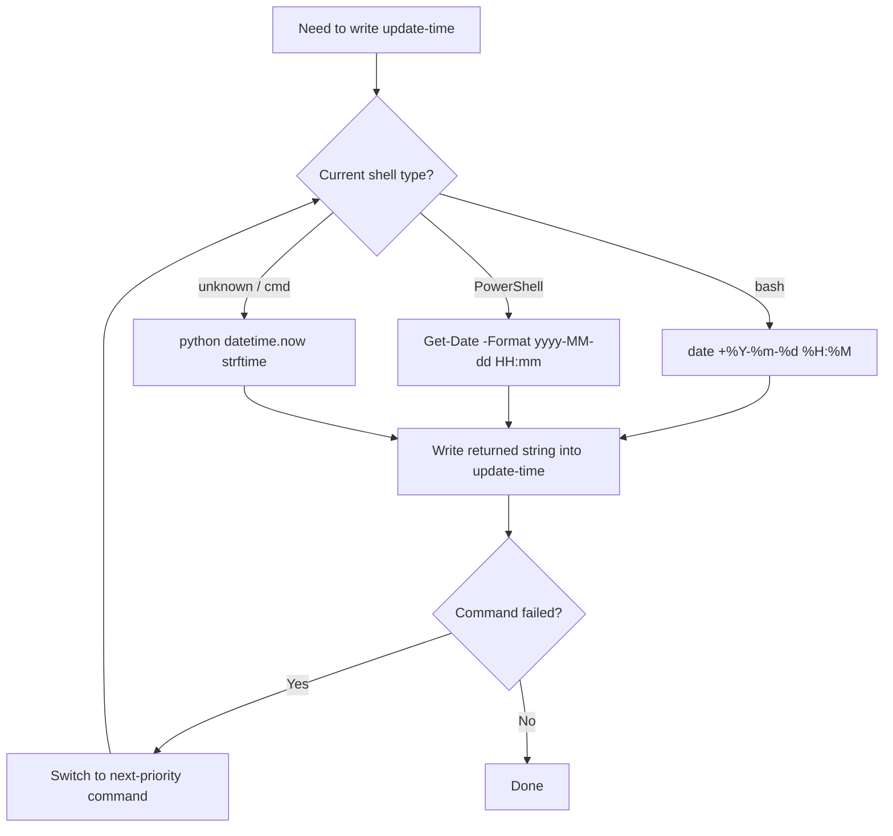
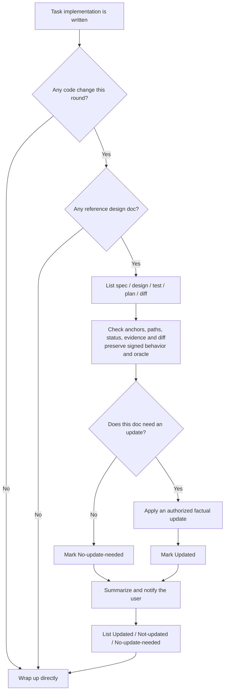
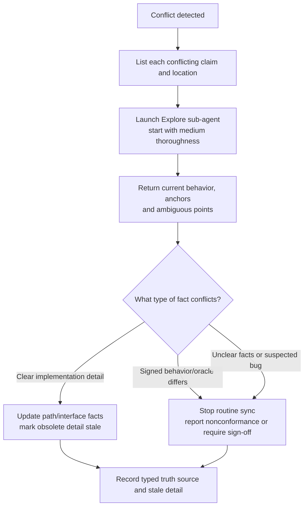

# Reverse sync between design docs and code (rules)

> This file is part of the `fibo-conventions` skill. It must be obeyed **at task wrap-up when this round touched code**.
> For the batch sync flow dual-triggered by commit / sync-only see `commit-sync.md`.

## 1. Trigger conditions and typed truth sources

As long as this task **simultaneously satisfies** the following two, reverse sync must be executed:

1. The task has one or more **reference design docs** (MD documents the user provided in conversation, or explicitly referenced in the code)
2. This task **actually modified / added code**

The `.fibo/docs/specs/<feature>/{spec,design,test,plan,diff}.md` quintet corresponding to this round's code change is treated as a reference design doc; as long as the feature directory can be uniquely located from the plan / spec / current task context, the user does not need to mention each explicitly this round.

**Core principle — choose the truth source by information type**:

| Information | Truth source | Reverse-sync behavior |
| --- | --- | --- |
| Intended external behavior, AC, test oracle | User-signed `spec.md` | Never rewrite merely to match current code; a mismatch is implementation nonconformance, or an intended change that must return to `fibo-brainstorming` |
| Validated architecture / design direction | `design.md` after the planning gates (or later explicit approval) | Correct factual anchors/names from code; a changed decision requires replanning rather than silent reverse sync |
| Implementation paths, current interfaces, filenames, call paths | Current code/config | Update implementation-detail descriptions and anchors from real facts |
| New test-source location | The `src/` → sibling `test/` mirror contract in `code.md` §0 and the validated test.md mapping | Do not bless a wrongly placed new test as a repo fact; return to planning/execution to repair it |
| Existing test files, commands, environment | Current repo test/config facts | Update existing-path/command/environment details without changing the oracle or using legacy layout as precedent for a new test |
| PASS / FAIL / flaky / waiver evidence | Latest real test execution | Only `fibo-testing` or an equivalent real run may update the result |
| Hunk explanation | Real diff / patch | Only `fibo-recording-diff` may generate/refresh it |

If code conflicts with signed behavior or a test oracle, do not mark the requirement stale based on code alone. Report the nonconformance and return to execution for repair; if the behavior change is intentional, obtain a new sign-off first. If facts remain unclear or a bug is suspected, stop and report instead of papering over the conflict.

### 1.1 Sync-target whitelist (crossing it is strictly forbidden)

Only the following kinds of MD documents **can** be targets of reverse sync:

| Type | Meaning |
| ---- | --------------------------------------------------------- |
| User docs | MD documents the user explicitly mentioned / gave a path to **in the current session** |
| AI-generated docs | MD documents the assistant created or modified **during the current session** |
| `.fibo/docs/specs/<feature>/{spec,design,test,plan,diff}.md` | The quintet **functionally corresponding** to this round's code change, treated as an implicit sync target; sync existing artifacts, create missing test.md only through planning, and create/refresh missing diff.md only from a real diff after final verification |

**Absolutely forbidden**:
- ❌ Do not scan "seemingly related" MD documents in the repo and add anchors on your own
- ❌ Do not touch documents mentioned in a historical session but not in this session
- ❌ Do not modify unrelated documents such as README, CHANGELOG, third-party dependency docs

---

## 2. Sync actions (only supplement / fix implementation details, do not change the business design)

**Primary target**: sync the `.fibo/docs/specs/<feature>/` quintet:

1. Backfill the code location into the "implementation location" area under the **corresponding AC entry** in `spec.md` using a code jump tag (`class=code`, see `markdown.md` §3), so AC ↔ code are presented side by side.
2. If `design.md` / `plan.md` exist, fix implementation-detail paths, interface names, and status/reference drift without silently changing approved behavior or design direction.
3. If `test.md` exists, update existing-test paths, commands, environment facts, and real execution evidence only. A `new` test source must still satisfy the nearest-project-root `src/` → sibling `test/` mirror; a wrong location is implementation nonconformance, not path drift that routine sync may normalize. A changed oracle, command, or implementation revision invalidates the prior PASS until Verify runs again. Do not change Given/When/Then, expected values, thresholds, or oracle to match the implementation.
4. If a real diff / patch / working-tree diff exists and final test evidence is PASS or explicit WAIVED, call `fibo-recording-diff` to generate or refresh `diff.md`; fabricating hunks from memory is forbidden. If prerequisites are missing, mark `diff.md` as `Not-updated` and explain why.

**Secondary target**: if the change belongs to cross-feature global design (e.g. adding a module, adjusting architecture), sync it to `.fibo/docs/architecture/<file>.md`; if it involves a new decision trade-off, create a new ADR under `.fibo/docs/decisions/`.

**Mandatory boundaries**:
- ✅ Allowed: **add / update** a code jump tag (implementation anchor) below an AC
- ✅ Allowed: fix implementation-detail descriptions and anchors inconsistent with current code/config facts
- ✅ Allowed: update existing-test paths/commands from repository facts and test results from a real run
- ✅ Allowed: add a short one-line implementation note next to the tag
- ✅ Allowed: generate or refresh `diff.md`'s reading order, hunk explanations, and cross-file Mermaid main line from the real diff
- ✅ Allowed: mark an obsolete implementation-detail description "stale, for reference only" while preserving history
- ❌ Forbidden: changing signed AC, test oracle, thresholds, expected results, or approved design direction merely because current code differs
- ❌ Forbidden: rewriting a planned `new` test path to accept `tests/`, source-adjacent placement, `src/**/__tests__/`, or a non-mirrored `test/` subtree merely because that file now exists
- ❌ Forbidden: reporting PASS without a real run, or converting FAIL/flaky to PASS through reruns without resolving/waiving the cause
- ❌ Forbidden: changing the existing chapter structure, heading levels, or Mermaid diagrams during routine sync
- ❌ Forbidden: deleting or rewriting a design description that has not become invalid
- ❌ Forbidden: adding content in the design doc that is not for the purpose of "implementation guidance"
- ❌ Forbidden: recording a hunk in `diff.md` that does not exist in the real diff / patch
- ❌ Forbidden: directly deleting a conflicting old AC / design decision / diff explanation to paper over historical context

**Clear purpose**: add clickable "design → implementation" anchors to the spec / design docs + fix implementation-detail drift, **not** rewrite the design.

### 2.1 Stale implementation-detail marking (for reference only)

When spec / design / test / plan / diff lags behind on an implementation detail, or multiple docs conflict on an interface name, file path, test command, task status, or hunk explanation:

1. Read the code/config or run evidence to confirm the current fact; for a multi-file call chain, use §5 adjudication.
2. Update still-valid implementation anchors, paths, commands, or result evidence from the matching truth source.
3. For an obsolete implementation-detail entry, keep it and append a stale mark.
4. If the conflict concerns intended behavior, AC, oracle, or threshold, **do not use this stale-mark flow**. Report implementation nonconformance or return to brainstorming for an intended behavior change.

Fixed format:

```
> Stale, for reference only: the current implementation detail defers to `src/foo.ts:120-155`; the original description is kept for understanding historical context.
```

Mandatory constraints:
- `Stale, for reference only` must appear verbatim, for retrieval.
- You must give the code source of truth (file path, with the line number or range when it can be located).
- This marker does not authorize superseding a signed AC or test oracle.
- If the same implementation-detail item affects other docs, all affected docs must be marked in sync, not just one.
- The sync report must state which stale items were marked this round and the source of truth.

### 2.2 Update the meta-info mark (must add on every update)

After **completing** each generation or update of any `.md` document, you must append an update-meta-info block at the **very end** of that document.
The format is fixed: a `---` separator above and below, with the document attributes in between.

Standard template:

```

---
name: {document display name}

update-time: {YYYY-MM-DD HH:mm}

description: {a one-sentence description of this content, for retrieval and location}

---

```

Example:

```
---
name: Auth module design

update-time: 2026-06-30 04:36

description: The overall design of the auth module: source of login state, Token store/expiry strategy, AC ↔ code anchors

---

```

Mandatory constraints:
- **Position fixed at the very end of the document**: it must not be stuffed anywhere else in the text
- **When generating / updating any MD document, the three fields `name` / `update-time` / `description` are all required**, none can be missing
- **`update-time` takes the current real time**, do not fabricate or leave blank
- **`description` is one sentence** (suggested ≤ 60 chars), summarizing the topic and scope; used for retrieval / indexing / an agent's decision on "whether to read this doc"
- **Keep one blank line below each field**, i.e. one blank line below each of `name`, `update-time`, `description`; the line below `description` must also be blank before writing the closing separator `---`, for display and readability
- **Overwrite-refresh this block on every update** (i.e. each document keeps only the **latest** meta-info block, do not stack historical updates into multiple blocks)

### 2.3 Obtain system time across OSes (mandatory)

`update-time` must take the **operating system's current real time**; writing from memory is forbidden, and reusing a "today's date" given in conversation is forbidden.
Choose the corresponding command by the current shell / OS, in **priority**: bash → PowerShell → Python fallback.

| Environment | Command |
| ----------------------------------- | ------------------------------------------------------------------------------- |
| bash (Linux / macOS / Git Bash) | `date "+%Y-%m-%d %H:%M"` |
| PowerShell (native Windows) | `Get-Date -Format "yyyy-MM-dd HH:mm"` |
| cmd (native Windows, not recommended) | `powershell -Command "Get-Date -Format 'yyyy-MM-dd HH:mm'"` |
| any-OS fallback | `python -c "import datetime; print(datetime.datetime.now().strftime('%Y-%m-%d %H:%M'))"` |

Execution flow:



Mandatory constraints:
- **You must actually run** the above command to get the time, it is **not allowed** to directly write an unverified value like `2026-04-28 12:00`
- **The format must be precisely `YYYY-MM-DD HH:mm`**: year-month-day space hour:minute (24-hour, no seconds, no timezone)
- **Multiple updates to the same document in the same session**: re-run the command each time to get the current time, do not reuse the previous value

---

## 3. Mandatory self-check flow at task wrap-up

Before every task ends (i.e. before telling the user "done"), you must run a self-check per the diagram below:



---

## 4. Format for notifying the user

At task wrap-up you must give a **design-doc sync report**, in the following format:

```
Design-doc sync report:
- .fibo/docs/specs/auth-login/spec.md : Updated (added 2 implementation anchors under AC-1, AC-3 + fixed 1 interface name per the code)
- .fibo/docs/specs/auth-login/test.md : Updated (refreshed 2 test paths and recorded final PASS from the real verification run; oracle unchanged)
- .fibo/docs/specs/auth-login/diff.md : Updated (refreshed the reading order and design logic of 3 files / 5 hunks based on the real working-tree diff)
- .fibo/docs/specs/auth-legacy/design.md : Updated (marked an obsolete interface path stale, for reference only; source of truth `src/auth/session.ts:120-155`)
- .fibo/docs/architecture/module-dependency.md : Not-updated (this round did not touch the global module dependency, add it at the next architecture adjustment)
- .fibo/docs/decisions/0003-token-store.md : No-update-needed (the decision itself is unchanged)
```

State enum (only these three, do not invent other states):

| State | Meaning |
| -------- | -------------------------------------------------- |
| Updated | This round did insert a code tag / implementation note in the doc |
| Not-updated | The doc **should** be supplemented but was **not** this round (a reason must be given) |
| No-update-needed | The doc is unrelated to this round's code change, or there is no supplementable implementation description |

> "Not-updated" must give a reason (e.g. waiting for user confirmation, the current implementation is not yet stable, the doc structure needs to be discussed first); **silently skipping is not allowed**.

---

## 5. Fact adjudication of inter-doc conflicts (must go through a sub-agent)

**Trigger conditions** (meeting any):
- During reverse sync you find **two or more** docs describing the same behavior / rule / interface inconsistently with each other
- A doc description is inconsistent with the code, and you **cannot directly judge the current code facts** (e.g. a multi-file call chain, complex branches)

**Handling flow**:



**Sub-agent task template** (fixed wording):

```
Task: investigate the code facts to adjudicate a doc conflict
Conflict points:
  - Doc A ({path}, section X) says: ...
  - Doc B ({path}, section Y) says: ...
Please read the relevant code and answer:
  1. What is the current real behavior?
  2. Key code anchors (with line ranges)
  3. Is there any ambiguity or possible bug
Read only, do not modify; do not change any file.
```

**Mandatory constraints**:
- ❌ Adjudicating from conversation history / memory is not allowed; you must actually launch an `Explore` sub-agent to read the code
- ❌ Skipping the trace is not allowed — the sync report must state the typed source of truth (spec, code/config, real run, or real diff)
- ❌ When code differs from signed behavior/oracle, do not silently change the requirement/test to paper over it; stop and route to repair or new sign-off
- ❌ When the code itself is in doubt, do not silently change the doc; stop and ask
- ✅ Default thoroughness=`medium`, use `very thorough` across multiple modules

---
name: Reverse-sync conventions between design docs and code

update-time: 2026-10-10 14:16

description: Reverse-sync rules for mirrored new-test paths and the five feature artifacts using typed truth sources and protected test oracles

---
