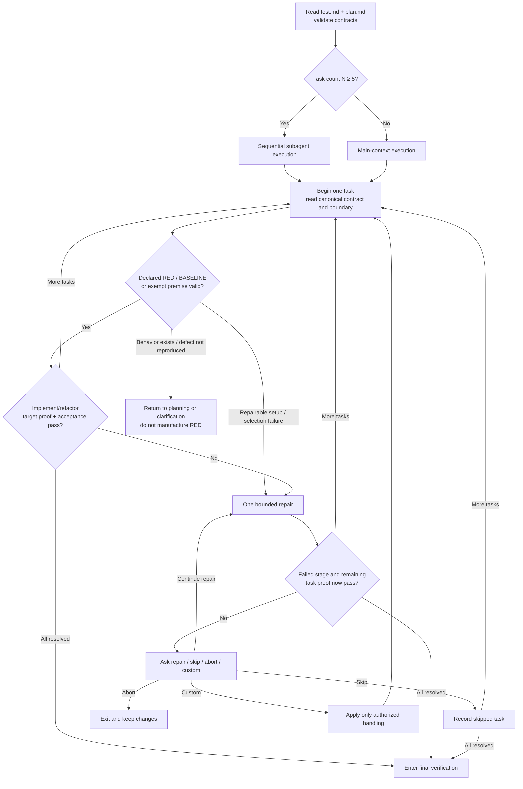
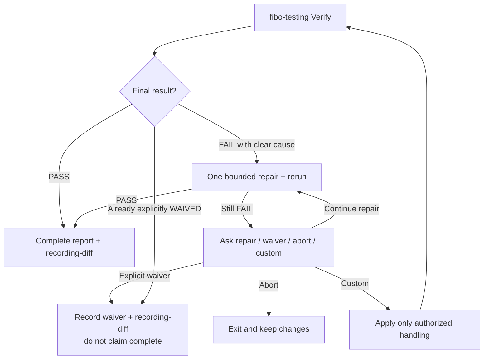
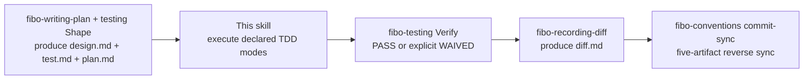

# Fibo executing-plan skill (executing-plan)

> This skill runs after plan.md is written to disk, implementing task by task in order.
> Input: `.fibo/docs/specs/<feature>/test.md` + `plan.md`
> Output: code/test changes + per-task TDD evidence + final verification evidence + entering `fibo-recording-diff` only after PASS or explicit WAIVED status

---

## When to use

✅ Applicable:
- The same directory has signed `spec.md` plus valid `design.md` / `test.md` / `plan.md` generated by `fibo-writing-plan`
- plan.md has at least 1 task in `[×]`, or all tasks are resolved but test.md still needs final Verify

❌ Not applicable:
- Missing test.md or plan.md → run `fibo-writing-plan` first
- All tasks are resolved and test.md already has current PASS / explicit WAIVED evidence → proceed to reporting or `fibo-recording-diff`
- plan.md has `[!] failed` but the user hasn't indicated how to handle it → the automatic repair attempt has already been exhausted; wait for the user's decision (do not start another repair on your own initiative)

---

## Core principles

1. **Tasks run in order, no concurrency**: to avoid file-write conflicts
2. **No dependency on git**: this project may not be a git repo; this skill does not do `status` / `diff` / `commit`
3. **Prompt-injected constraint, no post-hoc verification**: enforce the implementation boundary by writing the task's involved-files list + "do not modify files outside the list" into the executor prompt. The orchestrator alone may update status/evidence fields in sibling plan.md/test.md; this does not authorize changing their AC/TC, oracle, commands, or scope during execution
4. **Repair once, then pause; no rollback**: on a task's first failure, automatically diagnose and make one bounded repair attempt; only if the repaired task still fails, pause and let the user choose; do not auto-rollback completed or partial changes
5. **prod-code has an explicit test mode**: new behavior and regression require trustworthy RED; characterization and reuse-existing require BASELINE GREEN; exempt requires a reason and alternate verification
6. **Two completion levels**: an automated task needs targeted GREEN and a justified exempt task needs alternate verification before `[√]`; the feature needs `fibo-testing` Verify PASS before "Implementation complete ✓"
7. **Verifier does not repair**: final verification only records evidence; repairs remain in this skill's bounded failure flow

---

## Main flow





---

## Step 0: Read test.md + plan.md and gate

1. Read `.fibo/docs/specs/<feature>/test.md` and `plan.md`
2. Validate both trailing meta-info blocks contain `name` / `update-time` / `description`, with a real `update-time`
3. Validate every prod-code task references an existing TC and canonical test.md §5 row, declares the same TDD mode as test.md, and declares each test artifact `modify` / `read-only` / `none`; every concrete artifact also declares origin `new` / `existing`, while `none` has neither path nor origin
4. Validate every test artifact marked `modify` is inside that task's involved-files; a `read-only` artifact is never writable in this plan—if it must change, return to planning and redesignate it `modify`
5. For each test artifact marked `new`, validate test.md names its owning production `src/...` path and that the artifact sits under the sibling `test/` tree with the post-`src/` directory preserved (`src/a/c` → `test/a/c`). A new shared fixture/helper may omit the one-to-one source only when it declares `shared-support` and remains under that project's `test/`
6. Validate at least 1 task has status `[×]`, or all tasks are resolved but test.md still needs final Verify
7. If not satisfied → exit + state the reason; do not infer, relocate, or silently repair the planning contract during execution

---

## Step 1: Task-count decision for the subagent threshold

Read the "Task list" section of plan.md and count `### task-` lines = N.

- **N ≥ 5** → in Step 2, dispatch one Agent tool call per task (`subagent_type: general-purpose`), **sequential, serial** (no concurrency)
- **N < 5** → in Step 2, execute directly in the main context (avoiding subagent call overhead)


---

## Step 2: Single-task execution loop

### 2a. Inject prompt

Whether in the main context or a subagent, the prompt the executor receives **must include**:

- The task's full description
- The **involved-files list** (exact paths + globs)
- The **hard-constraint sentence**: "Do not modify any file outside the list"
- The task's involved AC / TC, declared TDD mode, canonical test.md §5 row, test-artifact access, exact RED or BASELINE reason, and TARGET/alternate-verification command read from test.md
- For every `new` test source, its owning `src/...` path, nearest project root, and expected mirrored `test/...` path; include the sentence "Create new test sources only at the declared mirrored path; do not use `tests/`, source-adjacent tests, or `src/**/__tests__/`"
- If the task's tags include `prod-code`: append "Follow the declared TDD mode and artifact access. For new-behavior/regression, create or select the targeted test first and confirm it fails only for the expected missing behavior/defect; do not modify a read-only test. For characterization/reuse-existing, establish the required BASELINE GREEN without manufacturing a failure. For exempt, run the declared alternate proof. Implement the minimum behavior, obtain targeted GREEN or alternate verification, refactor where applicable, and rerun. Do not mark the task done without evidence."
- The spec.md / design.md / test.md paths (let the executor read them itself, to avoid polluting the main context)
- **Code-comment convention reference**: the prompt must state explicitly "Follow §4 of `fibo-conventions/references/conventions/code.md`; when a key decision or non-obvious TC lands, or a doc is needed to explain intent, use the `spec:` / `design:` / `test:` line format with a full relative path (for example `test: .fibo/docs/specs/<feature>/test.md#TC-X`). Shorthand or isolated `task-09` / `D5` / `TC-3` is forbidden. Each reference gets its own line with an empty comment line between references. Do not annotate ordinary utilities or self-explanatory tests." A subagent cannot access the main context's memory, so the rules must be written into the prompt explicitly


### 2b. Execute

Run the task within the injected constraints. Create every declared `new` test source at its already validated mirrored path; execution may not choose a different test directory or reinterpret an existing legacy layout as authorization for a new path. For `new-behavior` / `regression`, create or select the targeted test before changing production code and confirm trustworthy RED; an already suitable failing test may remain `read-only`. For `characterization`, establish the test baseline before refactoring. For `exempt`, execute the documented alternate proof. Do not mark the task `[√]` until `[G] targeted-green` or `[V] alternate-verified` and the task acceptance method pass.

For RED validation:

- Accept it only when the failing assertion or observable result corresponds to the TC's expected missing behavior or reproduced defect.
- Reject environment setup, missing dependencies, syntax errors, unrelated compile failures, wrong test selection, and pre-existing unrelated failures as RED evidence.
- A compile/type failure counts only when the TC explicitly targets the absence of that public contract and the failure matches the documented expectation.
- If the test unexpectedly passes because the behavior already exists, or a claimed regression cannot be reproduced, stop and return to planning/clarification. Correct a wrong test selection if that is the diagnosed cause, but never weaken the oracle or alter a valid test merely to manufacture RED.

After observing each valid transition, the orchestrator—not the task executor—updates only the related status/evidence fields in test.md: `[R] red-confirmed` or `[B] baseline-green`, then `[G] targeted-green` after automated target proof, or `[V] alternate-verified` after a justified exempt proof.

### 2c. Acceptance

Run the task's exact acceptance command from plan.md / test.md:

- Targeted GREEN / alternate verification and acceptance pass → write back plan.md `[√]` and test.md `[G]` / `[V]`, then move to the next task (or, if all are resolved, proceed to Step 4)
- The executor errors or acceptance fails for the first time → keep the status `[×]` while proceeding to Step 3's single automatic repair attempt


---

## Step 3: One automatic repair + failure handling

### 3a. Automatic repair (exactly once before asking the user)

On the task's first repairable execution or acceptance failure:

1. Preserve the failure evidence and diagnose the direct cause with read-only checks.
2. Make **one focused repair attempt** within the task's original involved-files boundary and existing authorization. When no file edit is appropriate (for example, a transient executor failure), the repair may be a corrected re-execution after addressing the diagnosed cause.
3. Rerun the task's **original failing method unchanged** once (RED/BASELINE validation or acceptance, whichever failed).
4. If the failed method and all required subsequent task proof pass, mark the task `[√]` and continue automatically.
5. If execution or acceptance still fails, mark the task `[!]` and proceed to Step 3b.

One automatic repair attempt means one diagnosis-and-remediation cycle followed by one acceptance rerun. Diagnostic commands do not consume extra attempts, but repeated speculative edits or repeated acceptance reruns are forbidden. If a repair would require files outside the involved-files list, a changed acceptance contract, destructive action, new permission, or external coordination, do not cross that boundary; record it as the repair failure reason and proceed to Step 3b.

When a subagent executes the task, keep the repair serial. Reuse the same executor context when possible; otherwise provide the repair executor with the original failure evidence, the same involved-files list, and the same hard constraints.

### 3b. Ask the user only after the automatic repair also fails

After the automatic repair has been exhausted, **do not continue and do not roll back**. Report both failure stages and give the user four choices:

```
task-NN: <one-line title> failed
Initial failure: <invalid RED/BASELINE/exempt premise / executor error / acceptance command did not pass / file cannot be written / ...>
Automatic repair attempted: <what was repaired or why an in-scope repair was impossible>
Result after repair: <remaining error / acceptance output>

Done: task-01, task-02 (code changes kept, not rolled back)
Skipped: <task IDs, or none>
Not started: task-NN+1, task-NN+2, ...

Please choose one to continue:
(a) Continue repairing task-NN: make one additional focused repair attempt, then rerun the failed RED/BASELINE or acceptance method once
(b) Skip task-NN: mark it `[↷] skipped` and continue with task-NN+1 (accept an incomplete implementation)
(c) Abort the entire plan: keep all completed and partial changes; call this skill again when ready
(d) Other handling: provide instructions, such as "I fixed it manually; rerun acceptance" or authorize a specific scope / acceptance-method change
```

Continue only after the user chooses. **Do not select an option on the user's behalf.** If the user chooses (a), that authorization covers one additional repair-and-acceptance cycle; if it still fails, show the same four choices again. If the user chooses (b), mark `[↷]` before proceeding to the next task or Step 4. If the user chooses (d), follow only the handling they explicitly authorize.

---

## Step 4: Final feature verification

When every task is `[√]` or `[↷]`, invoke `fibo-testing` Verify. It runs the exact gates in test.md in this order:

1. All targeted tests from this implementation.
2. Feature/module regression.
3. Required lint / typecheck / build gates.
4. Risk- or AC-driven integration, E2E, security, or performance checks.

`fibo-testing` records commands, environment/revision, PASS/FAIL, and concise evidence in test.md; it does not modify production code or tests.

- **PASS**: mark applicable TC `[√] final-passed`; proceed to Step 5.
- **FAIL with a clear in-scope cause**: make one bounded repair within the union of the original plan tasks' involved-files boundaries; `read-only` test artifacts remain non-writable. Rerun the failed gate and its dependent gates once.
- **FAIL after repair, or repair needs a broader boundary**: mark test.md FAIL and pause. Offer (a) one additional explicitly authorized repair, (b) an explicit verification waiver with scope/reason/impact, (c) abort, or (d) custom handling.
- **WAIVED**: only after the user's explicit choice; write `[↷]` and the exact waiver evidence in test.md. Proceed to diff recording, but never use the complete-success wording.

Flaky reruns do not count as PASS until the cause is resolved or explicitly waived.

---

## Step 5: All-done report

Report the outcome only after Step 4 resolves. Use `Implementation complete ✓` only when every task is `[√]` and final verification is PASS. If a task is skipped, use `Plan execution finished with skips ⚠`; if verification is waived, use `Plan execution finished with verification waiver ⚠`. Both warn that the implementation is not fully proven.

```
<outcome line selected by the rule above>
- Involved files: <deduplicated union of all tasks' involved files>
- Task count: N (<done count> [√], <skipped count> [↷])
- Skipped tasks: <task IDs and impact, or none>
- Final verification: PASS / WAIVED (include waiver impact when applicable)

Next steps:
- Invoke fibo-recording-diff only now to generate .fibo/docs/specs/<feature>/diff.md, explaining hunk by hunk why this implementation is designed this way
- After diff.md is recorded, you may invoke commit-sync on the project to trigger reverse sync (per fibo-conventions/references/conventions/commit-sync.md)
- Or continue with the next feature
```


---

## Mandatory constraints

- ❌ Do not run tasks concurrently (sequential, serial)
- ❌ Do not enter this skill while test.md / plan.md is missing, unsigned, or fails the AC↔TC↔task contract
- ❌ Do not create a new test source outside the declared sibling `test/` tree or at a path that does not mirror its owning `src/` directory
- ❌ Do not add a post-hoc file-boundary verification step; this workflow intentionally enforces the boundary through the executor prompt
- ❌ Do not accept an environment/setup/unrelated failure as RED evidence
- ❌ Do not manufacture RED for characterization or reuse-existing tasks
- ❌ Do not mark a prod-code task `[√]` before targeted GREEN, or before `[V]` alternate verification for a justified exempt task
- ❌ Do not copy a second set of RED/GREEN commands into plan.md; execute the canonical test.md §5 row
- ❌ Do not claim feature completion before final Verify PASS
- ❌ Do not auto-rollback a failed task's code changes
- ❌ Do not make more than one automatic repair-and-acceptance cycle before asking the user
- ❌ Do not broaden the involved-files boundary, permissions, or acceptance contract during automatic repair
- ❌ Do not run `git add` / `git commit` / `git push` in any task
- ❌ Do not force non-`prod-code` tasks to write tests
- ❌ After the automatic repair also fails, do not decide repair / skip / abort / custom handling for the user
- ❌ Do not grant a verification waiver on the user's behalf
- ✅ Allowed: the orchestrator may write back only plan.md task status and test.md TC status/evidence immediately after each verified transition, even though these control-plane files are not task implementation files
- ✅ Allowed: after the user's explicit "continue repairing" choice, make one additional bounded repair-and-acceptance cycle
- ✅ Allowed: reference the spec.md / design.md / test.md paths in the subagent prompt for it to self-read

---

## Handoff to other skills



- **fibo-writing-plan**: the upstream of this skill; this skill consumes test.md + plan.md
- **fibo-testing**: supplies per-task TDD contracts and owns non-repairing final verification plus the evidence update
- **fibo-recording-diff**: invoked only after final PASS or explicit WAIVED evidence, to record the design-logic explanation of the real hunks
- **fibo-conventions**: after diff.md is recorded, the user may trigger its commit-sync flow

---
name: Fibo executing-plan skill

update-time: 2026-10-10 14:18

description: Execute AC↔TC tasks with mirrored src→test paths, trustworthy RED/BASELINE, bounded repair, and a final verification gate

---
