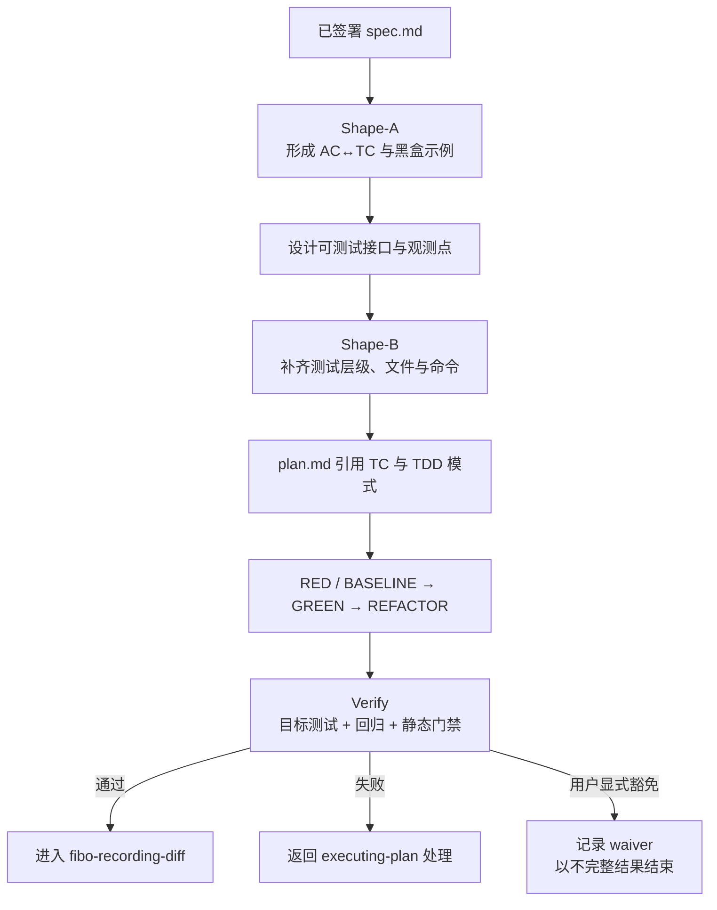

# Fibo 测试与验证 skill

> 本 skill 把 `test.md` 定义为 HOW TO PROVE：上承 `spec.md` 的预期行为，下接 `design.md` 的可测试接口、`plan.md` 的任务和真实自动化测试。
> 边界：它只覆盖已有已签署 spec 的 SDD feature；不强迫无 spec 的临时 bugfix / 探索性工作创建五件套。

## 适用模式

| 模式 | 触发点 | 输入 | 输出 |
| --- | --- | --- | --- |
| Shape-A | `spec.md` 已签署、`design.md` 尚未定稿 | spec + 仓库测试约定 | 黑盒验收模型：AC↔TC、正向/反向/边界示例、验证方法 |
| Shape-B | `design.md` 草稿已完成、`plan.md` 尚未生成 | spec + design + Shape-A 草稿 | 可执行测试契约：层级、文件、数据、环境、命令、TDD 模式 |
| Verify | `fibo-executing-plan` 的任务已执行完 | spec + design + test + plan + 当前工作树 | 最新真实结果、失败/waiver 及最终门禁状态 |

Shape-A 与 Shape-B 由 `fibo-writing-plan` 在内存中串行调用；全部硬校验通过后，才与 `design.md`、`plan.md` 一起写入磁盘。不得把半成品 `test.md` 留在 feature 目录。

详细集成规则见 `references/sdd-tdd-integration-guide.md`；生成文档时必须使用 `references/test.template.md`。

## 核心原则

1. **预期行为来自签署后的 spec**：不得为了匹配当前代码而改写测试 oracle。
2. **测试先影响设计，再影响任务**：先形成黑盒例子，再让设计提供测试接缝，最后让 plan 引用 TC。
3. **行为验证优先自动化**：可执行行为默认使用 `test`；使用 `analysis`、`inspection` 或 `demonstration` 时必须写明不可合理自动化的原因。
4. **不迷信单一覆盖率**：以 AC、风险和关键分支覆盖为硬约束；覆盖率阈值仅在项目已有标准或 AC 明确要求时采用。
5. **RED 必须可信**：失败必须由目标行为尚未实现或缺陷仍存在引起；环境、依赖、语法或无关编译失败不能算 RED。
6. **验证者不修实现**：Verify 模式只运行命令、判定结果、回填证据；修复返回 `fibo-executing-plan`。
7. **命令只维护一份**：RED / BASELINE / 目标验证命令以 test.md §5 为准；plan.md 只引用对应行，不复制出第二份可漂移的命令。
8. **新增测试源码镜像 `src/`**：以拥有目标 `src/` 的最近项目根为基准，`test/` 与 `src/` 同级，并原样镜像去掉 `src/` 前缀后的目录；例如 `src/a/c` 对应 `test/a/c`。

## 生命周期

## Shape 模式

### Shape-A：从需求形成验收模型

1. 提取 `SPEC_AC`；为每个 AC 建立至少一个 `TC-NN`。
2. 每个 TC 写明前置条件、动作、可判定预期，以及适用的反向、边界、异常或不利条件。
3. 为每个 TC 指定验证方法：`test | analysis | inspection | demonstration`。
4. 对安全、性能、兼容性等非功能 AC 写明量化阈值、负载/样本和判定方式。
5. 此阶段只定义外部可观察结果，不猜测具体函数、文件或 mock。
6. 如果无法为某条 AC 写出无歧义 oracle，或例子暴露出 AC 之间矛盾，停止 Shape；返回 `fibo-brainstorming` 修订并重新签署 spec，不得自行补意图。

### Shape-B：从设计形成可执行契约

1. 为每个 TC 选择最低成本且足以证明行为的层级：unit / component / contract / integration / e2e。
2. 补齐测试文件、fixture/数据、依赖隔离、环境和精确命令；每个测试工件声明 `new` / `existing` 来源以及 `modify`、`read-only` 或 `none` 访问方式。
   - 对每个 `new` 测试源码，先定位拥有目标 `src/` 的最近项目根，再记录生产源码路径与派生后的测试路径。`src/<relative-directory>/<source-file>` 的测试目录固定为 `test/<relative-directory>/`；文件名与测试后缀沿用该项目 runner 的约定。
   - 若项目根尚无 `test/`，由对应 task 在可写边界内创建；不得改用 `tests/`、源码旁置 `__tests__/` 或其他目录。
   - 无单一生产源码映射的共享 fixture/helper 仍须位于该项目的 `test/` 下，并在 test.md 写明 `shared-support` 理由和所选子目录。
   - `existing` 测试按仓库真实路径引用；本流程不自动迁移历史布局，但新增文件不得沿用历史偏离。
3. 为进入生产代码任务的 TC 指定 TDD 模式：
   - `new-behavior`：先 RED；
   - `regression`：先稳定复现缺陷形成 RED；
   - `characterization`：先建立 BASELINE GREEN，重构后保持 GREEN；
   - `reuse-existing`：引用已有自动化测试及其基线证据；
   - `exempt`：仅用于不产生可执行行为或确实无法合理自动化的任务，必须说明原因。
4. 建立最终门禁：目标测试、feature/module 回归、lint/typecheck/build，以及 AC 要求的安全/性能检查。
5. Epic 根 test.md 不伪造 task：master TC 要么标为 `delegated: <sub-feature>/TC-NN`，由子 feature 拥有 TDD 模式和任务；要么标为 `epic-verification-only`，只在跨 feature 最终门禁执行。

### 写盘前硬校验

- `TEST_AC = SPEC_AC`：不得漏 AC，也不得越界引用。
- 每个行为 AC 至少有一个自动化 TC；例外必须有理由和替代验证。
- 错误、禁止行为或异常路径 AC 至少有一个负向 TC。
- 所有 TC ID 唯一，且 plan 只能引用已存在的 TC。
- 每个需要新增/修改测试或实现的 TC 都映射到至少一个 task；仅复用既有证据或只在最终门禁运行的 TC 可标为 `verification-only`，并写明理由。Epic master TC 可用显式 `delegated` 映射代替本地 task。
- 普通 feature 的 `verification-only` 只豁免该 TC 的 task 映射，不豁免其 AC 的 plan 覆盖；`PLAN_AC` 仍须覆盖全部 `SPEC_AC`。
- 每个 `prod-code` 任务都引用 TC、TDD 模式和 test.md §5 的契约行；不得在 plan.md 另写一套 RED/GREEN 命令。
- 每个有具体路径的测试工件都声明来源 `new` 或 `existing`；`none` 不声明路径或来源。缺少来源时无法判断镜像规则，属于硬失败。
- 标为 `modify` 的测试工件必须进入对应 task 的 involved-files 可写边界；`read-only` 工件不得因追踪需要而被误列为可修改文件。
- 每个标为 `new` 的测试源码都声明目标生产源码，并通过路径镜像校验：最近项目根下的 `src/<relative-path>` 只能映射到同级 `test/<relative-path>`；测试文件名后缀可按 runner 约定变化，但中间目录不得变化。
- 新增 shared fixture/helper 若没有一对一源码映射，必须声明 `shared-support`，且路径仍位于同一项目根的 `test/` 下；运行时 coverage、截图、报告等产物不属于本测试源码路径契约。
- 行为 AC 不得仅以 `grep`、`ls`、文件存在或 build success 作为证明。

任一硬校验失败时，不写 `design.md`、`test.md` 或 `plan.md`，返回规划阶段修正。

## 执行状态与 TDD 判定

TC 状态固定为：

- `[×] planned`
- `[R] red-confirmed`
- `[B] baseline-green`
- `[G] targeted-green`
- `[V] alternate-verified`
- `[√] final-passed`
- `[!] failed`
- `[↷] waived`

`new-behavior` 和 `regression` 必须先创建或选定目标测试，并观察到符合预期原因的 RED；已有测试可以声明为只读，无须为了形式而改写。`characterization` 和 `reuse-existing` 不制造假 RED，而是先记录 BASELINE GREEN。若目标行为已经存在、回归缺陷无法复现，停止并返回规划/澄清，不得削弱 oracle 来强造 RED。自动化任务完成前必须得到 `[G]`；`exempt` 必须通过约定的替代验证得到 `[V]`；feature 完成前必须得到 `[√]`。

## Verify 模式

按 `test.md` 的命令/步骤顺序执行：

1. 本轮所有 targeted tests。
2. feature/module 回归集。
3. lint / typecheck / build 等静态门禁。
4. 风险或 AC 要求的集成、E2E、安全、性能检查。

结果规则：

- 执行前比较当前命令/待验证 revision 与旧证据；任何影响 oracle、命令或实现的变更都会使旧 PASS 失效，先把相关状态退回待验证。
- 全部通过：更新适用 TC 为 `[√] final-passed`，写入最新证据，返回 `PASS`。
- 任一失败：更新相关 TC 为 `[!]`，保留命令和失败摘要，返回 `FAIL`；不得自行修改代码或测试。
- 只有用户明确接受风险时才能写 `[↷]`；必须记录范围、理由、影响和批准语句，返回 `WAIVED`。
- flaky 重跑不能直接转成 PASS；先记录 flaky，查明原因或由用户显式 waiver。
- 对 analysis / inspection / demonstration，记录输入、步骤、产物/观察者和判定；agent 无法亲自观察的 demonstration 必须取得执行者的明确结果，不能自行写 PASS。
- 证据只保留最近一次有效快照和仍有效的失败/waiver；每条证据必须标识被验证的 commit，或在无 git 时标识工作树/环境快照；完整日志留在测试工具或 CI artifact。

`PASS` 才允许以 `Implementation complete ✓` 结束并进入 `fibo-recording-diff`。`WAIVED` 可以继续记录 diff，但必须使用“verification waiver”结果，不得声称完整通过。

## 真相源边界

| 信息 | 真相源 | 允许自动同步的内容 |
| --- | --- | --- |
| 预期行为、oracle | 已签署 `spec.md` | 不允许按代码静默改写；行为变更重新进入 brainstorming |
| 架构、测试接缝 | 已通过规划门禁的 `design.md` | 可按事实修正路径/接口；设计方向变化需重新规划 |
| 新增测试源码目录 | 本 skill 的 `src/` → `test/` 镜像契约 | 不允许把错误落盘位置反向同步成合法路径；应返回规划/执行修复 |
| 既有测试路径、命令、环境 | 当前仓库与配置 | 可以按真实仓库修正；不因此迁移历史测试，也不为新增测试放宽镜像规则 |
| 是否通过 | 最新真实执行 | 只能按运行结果更新 |

## 禁止事项

- ❌ Shape 模式不得写生产代码、测试代码或运行测试。
- ❌ Verify 模式不得通过修改测试来迎合当前实现。
- ❌ 不得把无关失败记录为 RED，也不得把 flaky 重跑成功当作稳定通过。
- ❌ 不得用全局固定覆盖率替代 AC↔TC 追踪。
- ❌ 不得把新增测试源码写入 `tests/`、`src/**/__tests__/`、源码同目录或任何未镜像 `src/` 相对目录的路径。
- ❌ 不得执行 `git add`、`git commit` 或 `git push`。

---
name: Fibo 测试与验证 skill

update-time: 2026-10-10 14:18

description: 在规划和执行之间维护 test.md，提供 AC↔TC、src→test 路径契约、可信 TDD 循环与最终验证门禁

---
