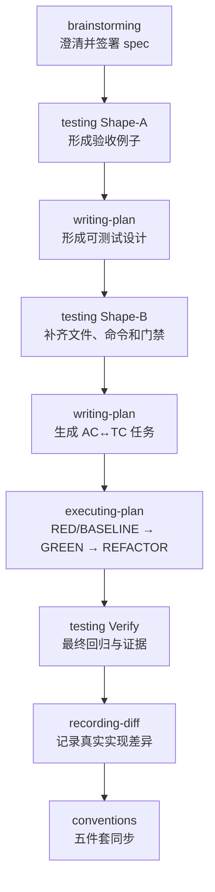
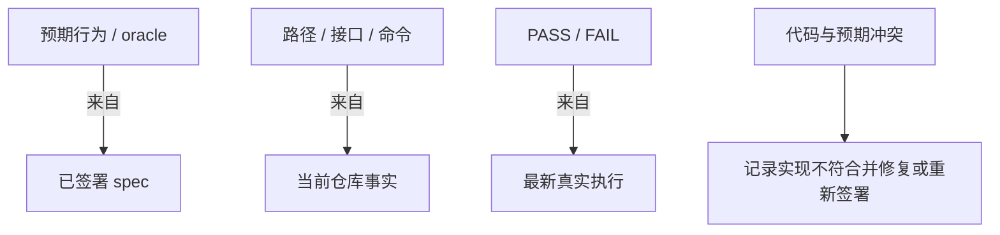

# Fibo SDD + TDD 变更指导

## 1. 目标

本变更把测试从 plan 中的自由文本“验收方法”提升为一等工程契约，使每个已签署 AC 都能追踪到测试用例、实现任务、自动化测试和最新验证结果。

普通 feature 的固定工件为：

| 工件 | 回答的问题 | 主要真相源 |
| --- | --- | --- |
| `spec.md` | WHAT / WHY | 用户签署的行为和边界 |
| `design.md` | HOW | 已通过规划门禁的架构与接口决策 |
| `test.md` | HOW TO PROVE | spec 的 oracle + 仓库测试事实 + 真实运行结果 |
| `plan.md` | HOW TO EXECUTE | AC/TC 驱动的任务分解 |
| `diff.md` | WHAT CHANGED | 真实 diff / patch |

## 2. 目标流程



关键顺序是“测试意图先于设计、测试实现晚于设计、任务晚于测试契约”。这样既能让验收例子影响可测试性，又不会在接口尚未确定时猜测测试文件和 mock。

## 3. Skill 职责变化

### 3.1 fibo-brainstorming

- AC 继续使用 EARS，并额外要求可形成明确 oracle。
- 签署后进入 writing-plan；writing-plan 内部调用 testing Shape-A/Shape-B。
- 行为变更必须重新签署；不得通过反向同步把当前代码直接提升为新需求。

### 3.2 fibo-writing-plan

- 输出由 `design.md + plan.md` 改为 `design.md + test.md + plan.md`。
- 写盘前同时校验 `SPEC_AC`、`TEST_AC`、`PLAN_AC`、TC 引用、测试文件边界及新增测试的 `src/` → `test/` 镜像路径。
- 三份文档作为一个规划集合校验；硬门禁未通过时全部不写，写盘故障则报告不完整状态并禁止进入实现。

### 3.3 fibo-testing

- Shape-A 负责黑盒验收模型。
- Shape-B 负责测试实现策略和命令。
- Shape-B 为每个新增测试源码记录生产源码映射，并在最近项目根下把 `src/` 后的目录镜像到同级 `test/`。
- Verify 负责真实执行与证据，不负责修实现。
- 如果 Shape-A 暴露无歧义 oracle 无法建立或 AC 相互冲突，返回 brainstorming 重新签署，不在测试文档里猜需求。

### 3.4 fibo-executing-plan

- `prod-code` 从“建议 TDD”改为“必须声明 TDD 模式”。
- 新行为/回归要求可信 RED；重构/复用使用 BASELINE GREEN。
- 自动化任务获得 targeted GREEN、合理 exempt 任务获得 alternate verification 后才能完成；所有任务之后再运行最终验证。

### 3.5 fibo-recording-diff

- 只在最终测试状态为 PASS，或用户明确留下 WAIVED 记录后运行。
- `diff.md` 可以解释测试文件 hunks，并引用 TC，但不复制测试计划和日志。

### 3.6 fibo-conventions

- 文档体系和同步白名单从四件套升级为五件套。
- 反向同步按信息类型选择真相源，不再笼统采用“code wins”。
- `test.md` 的路径、命令和结果可按事实更新；oracle 只能随已签署 spec 变化。

## 4. 测试契约规则

### 4.1 追踪关系


硬约束：

- `TEST_AC = SPEC_AC`。
- 排除获准的非行为 integrative task 后，`PLAN_AC = SPEC_AC`，且 task 引用的 AC/TC 必须存在。
- 每个需要新增/修改测试或实现的 TC 必须关联 task；只复用既有证据或只在最终门禁执行时可标为 `verification-only`。
- `verification-only` 是 TC 处置，不替代普通 feature 的 AC→task 覆盖；同一 AC 仍须由其实现/验证任务覆盖。
- 行为 AC 默认自动化；无法自动化时记录理由、替代方法和风险。
- 负向 AC 有负向 TC。
- 测试工件必须声明 `modify` / `read-only` / `none`；只有 `modify` 工件进入 task 的可写 involved-files 边界。
- 测试工件还必须声明 `new` / `existing`；每个 `new` 测试源码声明其生产 `src/...` 路径并通过 §4.2 的目录镜像校验。
- RED / BASELINE / TARGET 命令只在 test.md §5 维护；plan.md 引用契约行，不复制命令。

### 4.2 新增测试源码路径契约

路径契约以**拥有生产 `src/` 的最近项目根**为作用域：

```text
<project-root>/src/<relative-directory>/<source-file>
                 ↓ preserve relative-directory
<project-root>/test/<relative-directory>/<test-file>
```

例如：

| 生产路径 | 测试目录 / 文件 | 判定 |
| --- | --- | --- |
| `src/a/c` | `test/a/c` | 正确：目录一对一镜像 |
| `src/a/c/Foo.ts` | `test/a/c/Foo.test.ts` | 正确：目录镜像，文件后缀服从 runner |
| `packages/api/src/auth/Token.ts` | `packages/api/test/auth/Token.spec.ts` | 正确：monorepo 内按最近 package root 计算 |
| `src/a/c/Foo.ts` | `tests/foo.test.ts` | 错误：根目录名和相对目录均不符合 |
| `src/a/c/Foo.ts` | `src/a/c/__tests__/Foo.test.ts` | 错误：测试源码不得旁置于 `src/` |

规则边界：

- `src/` 与 `test/` 必须是同一项目根下的兄弟目录；不能用 workspace 根替代最近的 package/project 根。
- 去掉的只有生产路径最前面的 `src/`；其后的目录逐段保留。测试文件 basename / `.test` / `.spec` 等命名由项目 runner 决定。
- 项目尚无 `test/` 时，由 plan 在 involved-files 中声明并由实现 task 创建，不得因此退回 `tests/` 或源码旁置。
- 新增 shared fixture/helper 没有单一生产源码映射时，必须写 `shared-support: <reason>`，但仍须位于该项目的 `test/` 下，例如 `test/fixtures/` 或 `test/support/`。
- `existing` 历史测试按真实路径引用且不自动迁移；它只能作为复用/修改对象，不能成为新测试继续使用非标准目录的依据。
- coverage、截图、报告等 runner 运行产物不属于“测试源码文件”，路径由 runner/config 管理。

门禁顺序：writing-plan 先计算期望路径并写入 design/test/plan；executing-plan Step 0 再校验，只有通过后才允许创建测试。若落盘后发现路径错误，sync/commit-sync 报实现不符合并返回规划/执行，不能修改文档来追认错误位置。

### 4.3 验证方法

| 方法 | 适用对象 | 约束 |
| --- | --- | --- |
| test | 可执行行为、错误路径、接口契约 | 默认选择；应可重复、自判定 |
| analysis | 性能模型、静态性质、难以直接执行的约束 | 写明输入、计算和阈值 |
| inspection | 文档、配置、生成物结构 | 不得替代本可自动化的行为测试 |
| demonstration | 视觉或人工交互验收 | 写明步骤、预期和不可自动化原因 |

### 4.4 TDD 模式

| 模式 | 前置证明 | 完成证明 |
| --- | --- | --- |
| new-behavior | RED，且失败原因是行为缺失 | targeted GREEN + regression |
| regression | RED，稳定复现缺陷 | 缺陷测试 GREEN + regression |
| characterization | BASELINE GREEN | 重构后保持 GREEN |
| reuse-existing | 已有测试的基线证据 | 目标测试和 regression 继续 GREEN |
| exempt | 明确理由、`none`/只读工件和替代验证 | `[V] alternate-verified`；不能用于规避可执行行为测试 |

已有目标测试可以声明为 `read-only`，先确认 RED / BASELINE，无须为了形式而改写。若新功能其实已存在或缺陷无法复现，应返回规划/澄清；不能修改有效 oracle 来制造 RED。

## 5. 真相源与反向同步



不得执行以下同步：

- 因当前实现错误而改写 AC 或测试 Then/oracle。
- 因测试失败而降低阈值、删除断言或把用例标为通过。
- 用旧执行结果证明新 revision。

可以自动同步：

- 既有测试文件重命名后的真实路径。
- 测试 runner 或命令的真实变化。
- 最新实际执行结果。
- 代码/测试锚点和实现说明。

不得把新测试的错误落盘位置当成“当前仓库事实”同步进契约。对 `new` 工件，`src/` → `test/` 镜像规则高于错误实现；应修复文件与规划边界，而不是放宽 test.md。

任何影响 oracle、命令或实现 revision 的变更都会使旧 PASS 失效。新一轮 Verify 必须记录 commit；无 git 时记录可识别的工作树/环境快照。

## 6. Feature 与 Epic 结构

普通 feature 使用完整五件套。Epic 根目录使用 `spec.md + design.md + test.md + 子 feature 目录`：

- Epic `test.md` 负责 master AC、跨子 feature 集成/E2E 验收及总体证据。
- Epic 根目录不放 `plan.md` 或 `diff.md`。
- 每个子 feature 仍使用完整五件套，并独立签署、规划和验证。
- Master TC 要么 `delegated: <sub-feature>/TC-NN`，要么 `epic-verification-only`；Epic 根没有 plan，不创建虚假 task。
- 只有全部子 feature Verify PASS 后才运行 epic test.md；epic PASS 才完成大功能，任何 skip/waiver 都保留为不完整状态。

## 7. 失败与 waiver

最终验证失败时：

1. testing 记录真实命令、失败摘要和影响，返回 FAIL。
2. executing-plan 在原文件边界内进行一次有依据的修复并重跑。
3. 仍失败则等待用户选择继续修、跳过、终止或显式 waiver。
4. waiver 必须记录批准语句、范围、原因和未证明的风险。
5. 带 waiver 的结果不得称为完整通过。

## 8. 验收场景

变更完成后至少验证以下流程契约：

1. 新功能同时包含正常、边界和错误 AC。
2. 有对应已签署 AC 的 bugfix 先稳定复现缺陷，再修复。
3. 纯重构使用 characterization baseline，不制造假 RED。
4. 文档/配置任务允许 inspection，但不能替代行为测试。
5. 环境故障不能记为 red-confirmed。
6. 测试文件不在 involved-files 时规划失败。
7. targeted tests 通过但 regression 失败时 feature 不得完成。
8. 用户 waiver 被记录且最终报告明确为不完整。
9. spec/test oracle 与代码冲突时不会被自动反向改写。
10. Epic master AC 能追踪到 epic TC 或子 feature TC。
11. 复用既有测试时，测试文件保持只读且不会因追踪要求被纳入可写边界。
12. test.md 与 plan.md 不维护两套可能漂移的执行命令。
13. `src/a/c/Foo.ts` 的新增测试被派生到 `test/a/c/`，文件名后缀服从 runner。
14. 新增测试若声明为 `tests/foo.test.ts` 或 `src/a/c/__tests__/foo.test.ts`，规划阶段失败且不写三份文档。
15. monorepo 中 `packages/api/src/x` 映射到 `packages/api/test/x`，不会错误落到 workspace 根 `test/`。
16. 无单一源码映射的新增 fixture/helper 声明 `shared-support` 并位于项目 `test/` 下；运行产物不被误判为测试源码。
17. 反向同步发现新增测试落错位置时报告不符合，不会把错误路径吸收为新事实。

## 9. 业界实践映射与取舍

当前业界没有一个唯一、统一命名为“SDD + TDD”的标准流程，但已有几类成熟实践可以组合成同一条证据链：

| 实践 | 可借鉴部分 | 本方案中的落点 | 有意不照搬的部分 |
| --- | --- | --- | --- |
| GitHub Spec Kit 的 SDD | 先定义 WHAT，再逐步细化 plan/tasks；spec 可采用 living-spec 模型 | spec → design/test/plan 的分层，以及签署意图高于当前实现 | 不把 AI 生成的实现自动视为需求真相，也不把测试证据塞回 plan 自由文本 |
| Cucumber BDD / Example Mapping | Discovery → Formulation → Automation；用具体例子暴露歧义 | brainstorming + Shape-A 形成 AC↔TC 和正/反/边界例子，Shape-B 再落到自动化 | 不强制 Gherkin 或 Cucumber；沿用仓库现有测试框架 |
| TDD（Red–Green–Refactor） | 先列测试，再以小步 RED/GREEN 驱动接口和设计 | test.md §5 + executing-plan 的逐 task 循环 | 对 characterization/reuse-existing 不制造假 RED；exempt 必须有替代证据 |
| NASA/INCOSE 式需求验证矩阵 | 每条 requirement 映射 test / analysis / inspection / demonstration，并保留客观证据 | AC↔TC 矩阵、四类验证方法、最终证据与 waiver | 软件可执行行为仍默认自动化，不因“inspection”存在就降级可测试行为 |
| 风险分层测试 | 单元测试打底，关键路径补 integration/E2E，按风险选择层级 | “最低成本且足以证明”的层级选择 + 风险驱动最终门禁 | 不设跨项目统一覆盖率，也不要求所有 AC 都走昂贵 E2E |

这些映射的共同点不是“多写一份文档”，而是把意图、例子、可执行测试和运行证据连接起来。Fibo 的特有增强是：把 `test.md` 作为独立 living contract，明确 typed truth source，并对 agent 场景额外校验 RED 的失败原因，防止把环境错误或伪失败当作 TDD 证据。

参考资料：

- [GitHub Spec Kit：What is Spec-Driven Development?](https://github.com/github/spec-kit/blob/main/docs/concepts/sdd.md)
- [GitHub Spec Kit：Spec Persistence Models](https://github.com/github/spec-kit/blob/main/docs/concepts/spec-persistence.md)
- [Cucumber：Behaviour-Driven Development](https://cucumber.io/docs/bdd/)
- [Cucumber：Example Mapping](https://cucumber.io/docs/bdd/example-mapping/)
- [Martin Fowler：Test Driven Development](https://martinfowler.com/bliki/TestDrivenDevelopment.html)
- [Martin Fowler：TDD inside the agent loop](https://martinfowler.com/articles/exploring-gen-ai/tdd-in-the-agent-loop.html)
- [NASA Software Engineering Handbook：Verify Implementation](https://swehb.nasa.gov/spaces/SWEHBVB/pages/32604539/SWE-067%2B-%2BVerify%2BImplementation)
- [Google Testing Blog：How Much Testing is Enough?](https://testing.googleblog.com/2021/06/how-much-testing-is-enough.html)

## 10. 工作量与分阶段落地

### 10.1 本次已落地范围

这是“只改 skills、硬切换新流程”的第一阶段，不迁移历史 feature：

| 变更组 | 工作内容 | 当前状态 |
| --- | --- | --- |
| 新测试能力 | 新增 `fibo-testing/SKILL.md`、test 模板、本文档 | 已完成 |
| 上游规划 | brainstorming 提高 AC 可验证性；writing-plan 生成 design/test/plan | 已完成 |
| 实现闭环 | executing-plan 强制声明模式、可信 RED/BASELINE、TARGET 与最终 Verify | 已完成 |
| 下游记录 | recording-diff 在 PASS/显式 WAIVED 后记录真实 diff | 已完成 |
| 文档治理 | conventions 升级五件套、typed truth source、`src/` → `test/` 布局、同步与反模式规则 | 已完成 |
| 可执行静态检查器 | 自动解析 AC/TC/task、路径、状态和证据 schema 的脚本 | 本阶段未包含；当前由 skill 硬规则执行 |

本次共涉及 6 个 skill 包、18 个 Markdown 文件。因为没有引入测试框架、业务测试代码或历史迁移，主要工作量集中在流程契约、模板、跨 skill 门禁和一致性审查。

### 10.2 后续可选工作

| 阶段 | 典型投入 | 产出 | 是否必须 |
| --- | --- | --- | --- |
| 静态 lint | 约 0.5–1.5 工程日 | 校验 `TEST_AC = SPEC_AC`、TC/task 引用、状态枚举、工件访问和证据字段 | 建议，但不阻塞本流程使用 |
| 参考项目 pilot | 约 0.5–1 工程日 | 用新功能、bugfix、重构各跑一次并校准模板 | 建议 |
| CI 集成 | 约 0.5–2 工程日，取决于仓库数量 | PR 上自动跑 test-contract lint 与最终门禁 | 多团队/合规场景建议 |

以上是已有 runner、无需新增基础设施时的粗估；多语言 monorepo、设备/E2E 环境或受监管证据留存会显著增加投入。

### 10.3 每个新 feature 的持续成本

- 小型 feature（约 1–3 条 AC）：通常增加 15–30 分钟的人审，主要用于例子、负向路径和精确命令。
- 中型 feature（约 4–10 条 AC）：通常增加 0.5–1.5 小时的人审，并可能增加 fixture/隔离设计。
- Epic：除各子 feature 成本外，额外增加 master AC 分配与一次跨 feature 最终门禁。

这部分不是纯文档开销：它把原本散落在实现后排错、PR 追问和人工回归中的工作前移。若项目本来就有清晰 AC 和稳定测试命令，增量较小；若需求不可判定或测试环境不稳定，`test.md` 会较早暴露这些真实成本。

## 11. 非目标

- 不迁移或补写历史 feature 文档。
- 不批量搬迁历史上已位于其他目录的测试；本规则从新增测试源码开始硬执行。
- 不强迫无已签署 spec 的临时 bugfix 或探索性工作进入五件套；本方案只增强现有 SDD 链。
- 不引入新的业务测试框架；沿用各项目已有 runner。
- 不要求所有任务都写单元测试。
- 不设置跨项目统一覆盖率阈值。
- 不把完整 CI 日志存入 `test.md`。

---
name: Fibo SDD + TDD 变更指导

update-time: 2026-10-10 14:16

description: 指导 Fibo 以 test.md 串联 AC、src→test 路径、可测试设计、TDD 任务、验证证据和五件套同步

---
