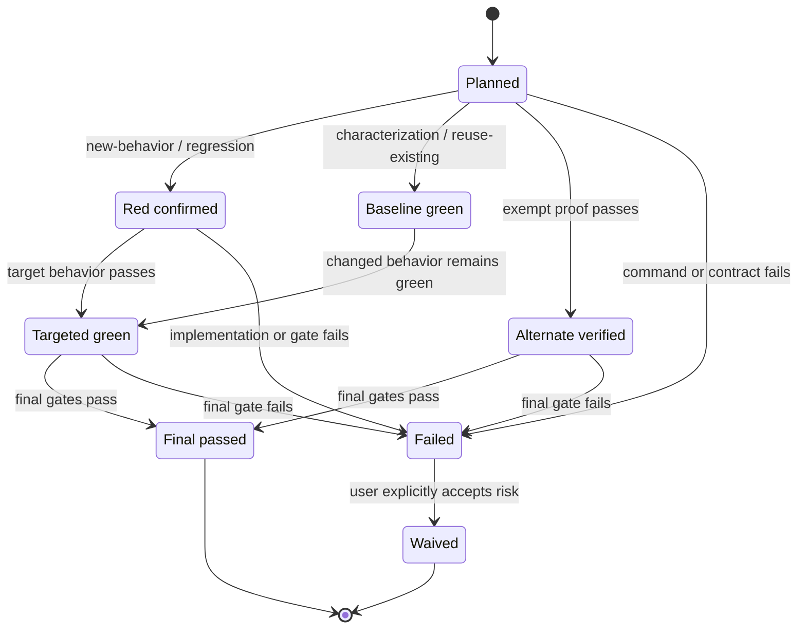

# {功能显示名称}测试与验证契约

> **用途**：说明如何证明 `spec.md` 的每条 AC 已实现，并记录与 `design.md`、`plan.md`、自动化测试及最新验证证据之间的追踪关系。
> **位置**：`.fibo/docs/specs/<feature-slug>/test.md`
> **边界**：本文档不复制测试源码，不保存完整测试日志，也不根据当前实现改写预期行为。

## 1. 范围与风险

- **覆盖范围**：{本轮覆盖的行为、模块和接口}
- **不覆盖范围**：{明确排除项及原因}
- **高风险路径**：{关键业务、安全、性能、兼容性或数据风险}
- **测试层级策略**：{为何选择 unit / component / contract / integration / e2e 的组合}

## 2. AC ↔ TC 追踪矩阵

| AC | TC | 验证方法 | 测试层级 | 自动化 | 关联 task / 处置 | 状态 |
| --- | --- | --- | --- | --- | --- | --- |
| AC-XX | TC-01 | test | unit | 是 | task-01 | [×] planned |
| AC-YY | TC-02 | demonstration | e2e | 否：{不可合理自动化的原因} | task-02 | [×] planned |
| AC-YY | TC-03 | test | integration | 是 | verification-only：最终回归门禁 | [×] planned |

硬校验：

- `TEST_AC = SPEC_AC`，覆盖率为 NN / NN = 100%。
- 所有 TC 引用的 AC 均存在，无越界引用。
- 每个行为 AC 至少有一个自动化 TC；例外项均记录替代验证和理由。
- 错误、禁止行为和异常路径 AC 均有负向 TC。
- 每个需要新增/修改测试或实现的 TC 均关联 task；`verification-only` 仅用于复用既有证据或最终门禁。
- 每个具体测试工件均声明 `new` / `existing` 来源及 `modify` / `read-only` 访问；`none` 不带路径和来源。
- 每个 `new` 测试源码均声明生产源码，并满足最近项目根下 `src/<relative-path>` → 同级 `test/<relative-path>` 的目录镜像。

## 3. 测试用例

### TC-01：{可观察行为标题} ↔ AC-XX

- **前置条件 / Given**：{状态、数据、依赖}
- **动作 / When**：{触发动作}
- **预期 / Then**：{可判定的输出、状态或副作用}
- **反向、边界或异常变体**：{输入边界、失败路径、不利条件}
- **验证方法**：test | analysis | inspection | demonstration
- **测试层级**：unit | component | contract | integration | e2e
- **自动化目标**：`test/a/c/Foo.test.ts`
- **TDD 模式**：new-behavior | regression | characterization | reuse-existing | exempt
- **RED / BASELINE 判据**：{预期失败原因，或特征化/复用测试的基线通过条件}

### TC-02：{下一个行为标题} ↔ AC-YY

{按相同结构填写。}

## 4. 测试实现方案

### 4.1 测试文件与接缝

新增测试源码的路径派生规则：以拥有生产 `src/` 的最近项目根为基准，`src/` 与 `test/` 同级；去掉 `src/` 前缀后原样镜像目录。目录示例：`src/a/c` → `test/a/c`。文件示例：`src/a/c/Foo.ts` → `test/a/c/Foo.test.ts`，其中 `Foo.test.ts` 仅为 runner 命名示例，实际后缀服从项目约定。

| TC | 生产源码 / 映射理由 | 测试工件 | 来源 | 动作/访问 | 被测接口/接缝 | 隔离方式 |
| --- | --- | --- | --- | --- | --- | --- |
| TC-01 | `src/a/c/Foo.ts` | `test/a/c/Foo.test.ts` | new | modify | `{public contract}` | fake / stub / real dependency |
| TC-03 | `src/a/c/Bar.ts` | `test/a/c/Bar.spec.ts` | existing | read-only | `{existing contract}` | real dependency |
| TC-01 | shared-support：{无单一源码映射的理由} | `test/fixtures/sample.json` | new | modify | `{shared fixture/helper}` | n/a |

路径边界：`new` 测试源码不得落在 `tests/`、`src/**/__tests__/` 或源码旁；shared fixture/helper 虽可不一对一镜像，也必须位于同一项目根的 `test/` 下。历史 `existing` 测试保留真实路径，不因本模板自动迁移。coverage、截图、报告等运行产物不属于此表的测试源码路径契约。

### 4.2 数据、环境与依赖

- **Fixture / 测试数据**：{来源、构造与清理}
- **环境**：{运行时、服务、数据库、浏览器或设备}
- **依赖隔离**：{mock/fake 的范围及不应 mock 的公共契约}
- **确定性控制**：{时间、随机数、并发、网络等}

## 5. TDD 执行契约（命令真相源）

> plan.md 只引用本表行；不得复制并维护另一套命令。

| Task / 用途 | TC | 模式 | 测试工件访问 | RED / BASELINE 命令 | 预期原因 | TARGET / 替代验证命令 |
| --- | --- | --- | --- | --- | --- | --- |
| task-01 | TC-01 | new-behavior | `test/a/c/Foo.test.ts` (new, modify) | `{exact command}` | {只因行为尚未实现而失败} | `{exact command}` |
| task-02 | TC-02 | exempt | none | 不适用：{原因} | {替代证明前提} | `{exact inspection/demonstration steps}` |
| verification-only | TC-03 | reuse-existing | `test/a/c/Bar.spec.ts` (existing, read-only) | `{exact baseline command}` | {既有覆盖基线} | `{exact final-gate command}` |

状态固定为 `[×] planned`、`[R] red-confirmed`、`[B] baseline-green`、`[G] targeted-green`、`[V] alternate-verified`、`[√] final-passed`、`[!] failed`、`[↷] waived`。

### 5.1 Epic 根契约变体（仅 master test.md）

Epic 根目录没有 plan.md，不创建虚假 task。每个 master TC 使用以下二选一处置：

| Master TC | 处置 | 子 feature 证据或跨 feature 命令 | 状态 |
| --- | --- | --- | --- |
| TC-01 | delegated: `<sub-feature>/TC-02` | `.fibo/docs/specs/<epic>/<sub-feature>/test.md#TC-02` | [×] planned |
| TC-02 | epic-verification-only | `{exact integration/E2E command}` | [×] planned |

## 6. 最终门禁

| 顺序 | 门禁 | 命令 / 引用 | 通过条件 | 必需性 |
| --- | --- | --- | --- | --- |
| 1 | Targeted tests | 复用 §5 所有相关 TC 的 TARGET 命令（不复制） | 本轮 TC 全部通过 | 必需 |
| 2 | Feature/module regression | `{exact command}` | 无新增失败 | 必需 |
| 3 | Lint / typecheck / build | `{exact command}` | 命令退出码为 0 | 按变更类型 |
| 4 | Integration / E2E / security / performance | `{exact command}` | {AC 量化阈值} | 按风险/AC |

## 7. 最新验证证据

| 时间 | 门禁/TC | 命令 | 环境或 revision | 结果 | 摘要 |
| --- | --- | --- | --- | --- | --- |
| {YYYY-MM-DD HH:mm} | TC-01 | `{exact command or documented steps}` | `{commit；无 git 时写工作树/环境快照；人工演示写观察者}` | PASS / FAIL | {简明结果，不粘贴完整日志} |

**最终状态**：PLANNED | EXECUTING | PASS | FAIL | WAIVED

> 影响 oracle、命令或实现的变更会使旧 PASS 失效；验证新 revision 前先把相关 TC 退回待验证，不得沿用旧证据。

## 8. 失败、flaky 与 waiver

| 项目 | 类型 | 原因 | 影响 | 处理/批准 |
| --- | --- | --- | --- | --- |
| {TC 或门禁} | failure / flaky / waiver | {事实} | {未证明的行为或风险} | {修复动作，或用户明确批准语句} |

## 9. 相关文档

    
        <a target="_self" href="#.fibo/docs/specs/<feature-slug>/spec.md?class=text" style="color: inherit; text-decoration: none;">
            Document: .fibo/docs/specs/<feature-slug>/spec.md
        </a>
    

    
        <a target="_self" href="#.fibo/docs/specs/<feature-slug>/design.md?class=text" style="color: inherit; text-decoration: none;">
            Document: .fibo/docs/specs/<feature-slug>/design.md
        </a>
    

    
        <a target="_self" href="#.fibo/docs/specs/<feature-slug>/plan.md?class=text" style="color: inherit; text-decoration: none;">
            Document: .fibo/docs/specs/<feature-slug>/plan.md
        </a>
    

    
        <a target="_self" href="#.fibo/docs/specs/<feature-slug>/diff.md?class=text" style="color: inherit; text-decoration: none;">
            Document: .fibo/docs/specs/<feature-slug>/diff.md
        </a>
    

---
name: {功能显示名称}测试与验证契约

update-time: {YYYY-MM-DD HH:mm}

description: {一句话说明本测试契约覆盖的 AC、风险、TDD 模式和最终门禁}

---
