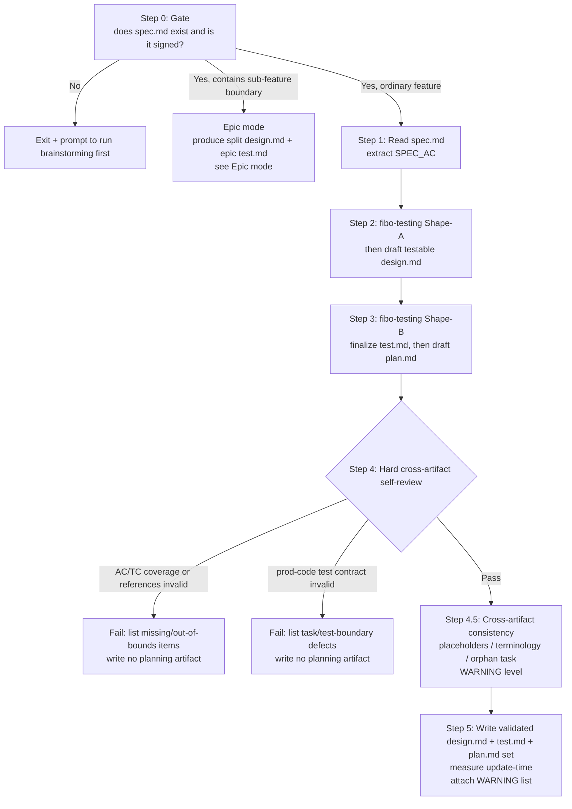
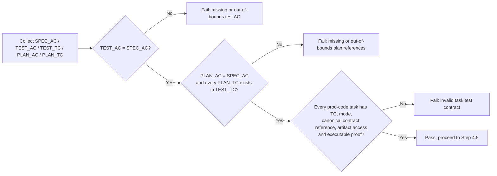
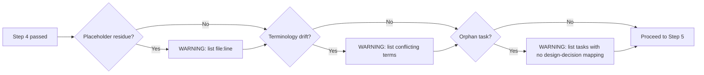
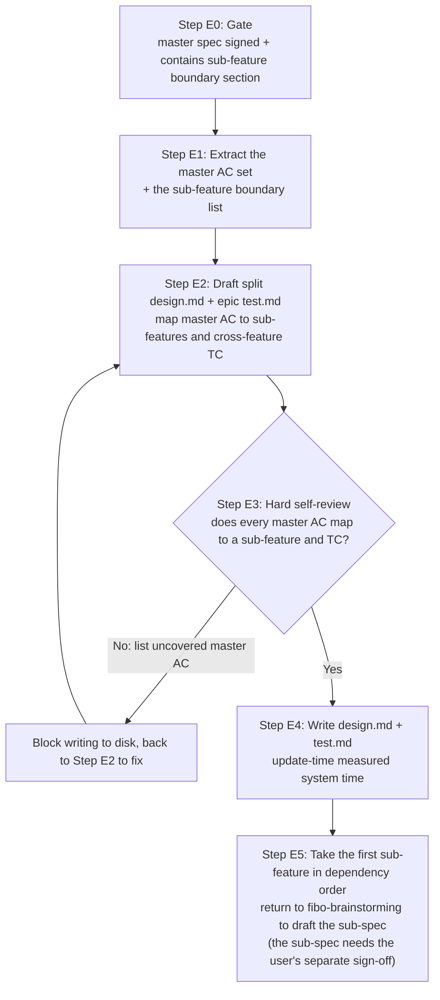
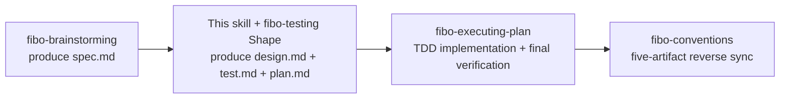

# Fibo writing-plan skill (writing-plan)

> This skill runs after spec.md is signed off and before any code is written.
> Input: `.fibo/docs/specs/<feature>/spec.md` (signed off)
> Output: `design.md` + `test.md` + `plan.md` in the same directory, serving as the input to `fibo-executing-plan`

---

## When to use

✅ Applicable:
- spec.md has been signed off via `fibo-brainstorming` (the meta-info block `update-time` is a real timestamp, not a `{...}` placeholder)
- Ready to enter the implementation stage, but "how to break down tasks / how to implement" is not yet decided
- spec.md is a **large-feature master spec** (contains a `## Sub-feature boundary` section) → run this skill's **Epic mode** (see §Epic mode): produce split design.md + epic test.md, not plan.md

❌ Not applicable:
- spec.md does not exist or is unsigned → run `fibo-brainstorming` first
- The same directory already has a valid `design.md` + `test.md` + `plan.md` → go directly to `fibo-executing-plan`
- Merely changing 1–2 AC of spec.md → re-run `fibo-brainstorming` Lightweight mode to change the spec, then come back to this skill to update design / test / plan together

---

## Core principles

1. **No writing code, no touching files until just before writing to disk**: this skill only produces design.md + test.md + plan.md, touching no code or tests
2. **AC verification coverage must be 100%**: every AC in spec.md must be covered by at least 1 TC in test.md and at least 1 task in plan.md
3. **No out-of-bounds references allowed**: test.md / plan.md cannot reference an AC or TC that does not exist upstream
4. **Every design decision must ↔ AC**: in design.md's "key design decisions" section, each entry must end with `↔ AC-NN`
5. **Every prod-code task has a test contract**: it must reference TC, declare a TDD mode, reference the canonical test.md §5 row, declare each test artifact's access, and use executable behavioral proof unless explicitly exempt with a reason
6. **Planning artifacts move as a set**: validate design.md / test.md / plan.md together; if any hard check fails, write none of them
7. **Meta-info block values measured for real**: the trailing meta-info block of all three documents must contain `name` / `update-time` / `description`; `update-time` is measured, not recalled
8. **New test sources mirror production sources**: within the nearest owning project root, `src/` and `test/` are siblings and the directory below `src/` is mirrored below `test/` (`src/a/c` → `test/a/c`)

---

## Main flow

---

## Step 0: Gate (whether spec.md is signed)

Read the trailing meta-info block of `.fibo/docs/specs/<feature>/spec.md`. Criteria for "signed off":
- The file exists
- The `update-time` field is in `YYYY-MM-DD HH:mm` format, **not** a `{...}` placeholder or empty

Unsigned → exit this skill and prompt the user to run `fibo-brainstorming` first.

---

## Step 1: Read spec.md and extract AC

Use a regex to extract all numbers of the form `AC-[A-Z0-9]+` (compatible with `AC-01` / `AC-A1` / `AC-B2` and other naming styles). Aggregate into the set `SPEC_AC = {AC-A1, AC-A2, ...}`.

Save each AC's title (`- **AC-XX**: ...`) as a mapping table, for reference in Steps 2 / 3, to avoid re-reading spec.md.

---

## Step 2: Shape acceptance tests, then draft design.md

First invoke `fibo-testing` Shape-A against the signed spec. Keep the resulting test draft in memory. It must establish `SPEC_AC ↔ TC`, concrete positive / negative / boundary or adverse examples, and verification methods without guessing implementation files.

If Shape-A cannot derive an unambiguous oracle, or its examples expose conflicting AC, stop and return to `fibo-brainstorming` for a revised sign-off. Do not resolve requirement intent inside design.md or test.md.

Then draft design.md and use the Shape-A cases as design input: public contracts, dependency seams, observability, deterministic time/randomness/concurrency control, and failure surfaces must be testable at the lowest sufficient layer.

Follow the 6 body sections plus trailing meta-info block in `fibo-conventions/references/design.template.md`:

1. **Goal** — one paragraph summarizing which spec AC this design implements
2. **Key design decisions** — one paragraph per decision, **each ending with `↔ AC-NN`** (one or more)
3. **File list** — a table listing "new / modified / untouched" files + purpose + corresponding AC
4. **Interface contract** — how skills / modules communicate (including a Mermaid call diagram)
5. **Interaction with existing modules** — a table listing affected existing modules + degree of impact
6. **Related** — links to sibling spec.md and test.md
7. **Trailing meta-info block** — `name` / `update-time` / `description` (`update-time` filled with system time)

**Mandatory**: every decision must carry `↔ AC-NN`; any decision paragraph without an AC attached is rejected from being written.

When the file list contains a new test source, derive it from the owning production source: locate the nearest project root that owns the target `src/`, replace only the leading `src/` with its sibling `test/`, preserve the remaining directory path, and apply the repository's test filename suffix. Record both paths in the design draft so Shape-B can validate the mapping.

---

## Step 3: Finalize test.md, then draft plan.md

Invoke `fibo-testing` Shape-B with spec.md + the design.md draft. Use `fibo-testing/references/test.template.md` to finalize:

- AC ↔ TC traceability
- verification method and test level
- test files, fixtures/data, environment and dependency isolation; each test artifact also records `new` / `existing`, and every `new` test source records its owning `src/...` path
- TDD mode plus exact RED / BASELINE / GREEN commands
- final targeted, regression, static and risk-driven gates

Only after test.md is complete, draft plan.md.

Follow the `references/plan.template.md` skeleton:

1. **AC coverage self-review table** (list it first, for reuse in Step 4)
2. **Task list**, each task containing these fields:
   - `task-id` (e.g. task-01)
   - Description
   - Involved AC (list; tasks marked "integrative" may fill in `-`)
   - Involved TC (`TC-NN`; non-behavioral integrative tasks may fill in `-`)
   - TDD mode (`new-behavior` / `regression` / `characterization` / `reuse-existing` / `exempt: reason`; non-prod tasks use `-`)
   - Test contract reference (the canonical row in test.md §5; do not duplicate commands; non-prod tasks may use `-`)
   - Test artifacts and access (`modify` / `read-only` / `none`)
   - Test-artifact origin and source mapping (`new` / `existing`; a new test source names its owning `src/...`, while shared support states `shared-support: <reason>`)
   - Involved files (exact path / glob; every `modify` test artifact is included, while `read-only` artifacts need not be writable)
   - Acceptance method (the referenced TARGET/alternate proof plus any task-specific check; `ls` / `grep` alone is allowed only for structural non-behavior tasks)
   - Tags (`skill-doc` / `prod-code` / `config`, etc.)
   - Status (`[×]` not done / `[√]` done / `[!]` failed / `[↷]` skipped by user decision)
3. **Execution order** + **failure handling**

**Special allowance**: a task marked "integrative" (e.g. modifying an entry file, adding a README) may have empty involved AC/TC and does not participate in AC/TC coverage. If it also carries `prod-code`, the allowance is revoked and a test contract is required.

---

## Step 4: Self-review before writing to disk (mandatory)

Also apply every hard gate in `fibo-testing` Shape mode, including automated behavior coverage, negative-case coverage, TC-to-task/verification-only disposition, test-artifact origin/access, and the new-test path mirror. Require `PLAN_AC = SPEC_AC` after excluding allowed non-behavioral integrative tasks, require every plan AC/TC reference to exist upstream, and require plan TDD modes to match test.md. Every concrete test artifact must declare `new` or `existing`; `none` has neither a path nor an origin. For each `new` test source, compute the expected path from its owning `src/...` path and nearest project root; a mismatch is a hard failure. Shared fixture/helper without one source mapping must declare `shared-support` and remain under that project's `test/`. On failure, **write none of the three artifacts**; report the exact missing / out-of-bounds / invalid items, fix the drafts, then rerun the full review.

---

## Step 4.5: Cross-artifact consistency check (WARNING level, does not block writing to disk)

> Inspired by the cross-artifact checking idea of spec-kit's `/analyze` command, **but only produces WARNINGs and does not block writing to disk** — Step 4 has already blocked the hard errors that "must be fixed", like AC coverage / out-of-bounds; this step specializes in catching the soft issues that are "easy to miss, cheap to fix".

### 4.5.a Placeholder residue

Search the following strings across the four drafts `spec.md` / `design.md` / `test.md` / `plan.md`; a hit produces a WARNING:

- `TODO` / `FIXME` / `XXX`
- `???` / `<to fill>` / `<TBD>` / `TBD`
- Unreplaced brace placeholders like `{Feature display name}` / `{feature-slug}`

> WARNING line format after a hit: `WARN-P1: <file>:<line> residual placeholder "<text>"`

### 4.5.b Terminology drift

Extract key terms from spec.md (proper nouns / module names / config-item names appearing ≥ 2 times), and check whether the casing / hyphenation / Chinese-vs-English of references in design.md / test.md / plan.md matches spec.md. Examples:

- spec.md writes `commit-sync`, design.md writes `CommitSync` → WARN
- spec.md writes `reverse sync`, plan.md writes `backward sync` → WARN

> WARNING line format: `WARN-P2: term "<spec spelling>" is written as "<deviating spelling>" in <file>`

### 4.5.c Orphan task

Cross-reference each task's "involved files" in plan.md against design.md's "file list" and test.md's test-file table:

- If a task's production file is **completely absent** from design.md's file list → this task may have no corresponding design decision → WARN
- If a task has a `modify` test artifact absent from involved-files, or a `read-only` artifact is mislabeled as writable merely for traceability → this is a Step 4 hard failure, not a WARNING
- If a `new` test source is outside the owning project's `test/` tree or does not mirror the directory below `src/` → this is a Step 4 hard failure, not a WARNING
- Tasks marked "integrative" are exempt

> WARNING line format: `WARN-P3: task-NN <title> involved file <path> has no correspondence in design.md's file list`

### 4.5.d WARNING disposition

- WARNINGs **do not block writing to disk**; Step 5 proceeds normally
- **Attach the WARNING list** in the Step 5 report, letting the user decide "fix now / leave to the implementation stage / don't fix"
- With 0 WARNINGs, **silently let it through**; don't boast "all green" in the report

---

## Step 5: Write design.md + test.md + plan.md to disk

1. Run the cross-OS command to get the system time (see `fibo-conventions/references/conventions/sync.md` §2.2)
2. Fill `name` / `update-time` / `description` into all three meta-info blocks
3. Write `.fibo/docs/specs/<feature>/design.md`, `test.md`, and `plan.md` as one validated planning set; initialize new/changed TC as PLANNED and invalidate evidence tied to a superseded oracle, command, or revision. If any write fails, report the incomplete state and do not start implementation
4. Report: all three files are written, `update-time` consistent; **if Step 4.5 has WARNINGs, attach the list** (list only if ≥ 1; with 0, silently let it through)
5. **Immediately auto-invoke the `fibo-executing-plan` skill**: execute plan.md using test.md's TDD contract, then run `fibo-testing` Verify before recording the diff

> **Do not stop to ask "should we enter implementation"** — this skill's entry already implies "implementation" authorization (spec already signed = run the full chain). Only stop in the following cases: Step 4 self-review fails; the user explicitly calls a halt during the chaining.

---

## Epic mode (dedicated branch for a large-feature master spec)

> Trigger condition: the spec.md read in Step 0 contains a `## Sub-feature boundary` section (produced by `fibo-brainstorming` Step 0.5).
> Source of truth for directory structure and identification rules: `fibo-conventions/references/conventions/docs-system.md` §3.1.

**Difference from ordinary mode**: produce `specs/<epic>/design.md` (the split design) plus `specs/<epic>/test.md` (master-AC and cross-sub-feature verification), **not plan.md**; implementation-level design / test / plan sink down to sub-features.

**The `## Sub-feature splitting` section of the split design.md must contain 4 blocks**:

1. **Sub-feature list**: each item contains a directory name (lowercase hyphenated English) + a one-sentence responsibility boundary
2. **Dependency order**: the implementation precedence and rationale among sub-features (even with no dependencies, explicitly write "no dependencies, follow the list order")
3. **Master AC ↔ sub-feature mapping table**: which sub-feature(s) each master AC lands in; this is the input to the Step E3 self-review
4. **Status table**: one row per sub-feature, status values `[×]` not started / `[→]` in progress / `[√]` Verify PASS / `[!]` blocked or failed / `[↷]` skipped or waived (incomplete); write back after each sub-feature chain resolves

The epic test.md must cover every master AC and contain cross-sub-feature integration / E2E cases where the behavior cannot be proven inside one sub-feature. A master TC is either `delegated: <sub-feature>/TC-NN` (the child owns its TDD mode/task) or `epic-verification-only` (the root owns an exact final-gate command); do not invent an epic task because the root has no plan.md. The mapping and eventual evidence remain visible in epic test.md. After all sub-features reach `[√]`, the orchestrating brainstorming flow must run the epic gates; only epic PASS completes the large feature.

**Epic-mode iron rules**:

- ❌ Do not produce plan.md / diff.md under `specs/<epic>/`; test.md is required
- ❌ Do not write implementation details in the split design.md (file list / interface contract belong to the sub-feature design.md's responsibility)
- ❌ Do not auto-generate a sub-feature's spec.md — each sub-spec must go back to `fibo-brainstorming` to be signed off separately
- ❌ Do not directly chain to `fibo-executing-plan` (Epic mode has no plan.md to execute)
- ✅ After writing to disk, immediately enter the first sub-feature's brainstorming in dependency order, advancing only one sub-feature at a time

---

## Mandatory constraints

- ❌ Do not enter this skill while spec.md is unsigned
- ❌ Do not write code / tests, run tests, or commit
- ❌ Do not let any task reference an AC number that does not exist in spec.md
- ❌ Do not let test.md miss an AC, invent an AC, or let plan.md reference an unknown TC
- ❌ Do not allow a prod-code task without a TDD mode, canonical test-contract reference, declared test-artifact access, and valid writable boundary
- ❌ Do not plan a new test source under `tests/`, beside production code, under `src/**/__tests__/`, or in a non-mirrored `test/` subtree
- ❌ Do not let any "key design decision" paragraph in design.md lack `↔ AC-NN`
- ❌ Do not fill `update-time` from memory (you must run the command)
- ❌ Do not force writing to disk when the self-review fails
- ✅ Allowed: show the design / test / plan draft when the user explicitly requests an extra review; otherwise the signed spec plus this skill's hard gates are sufficient, with no second sign-off
- ✅ Allowed: tasks marked "integrative" may have empty involved AC (e.g. modifying the CLAUDE.md entry)

---

## Handoff to other skills

- **fibo-brainstorming**: the upstream of this skill (the Step 0 gate checks its deliverable)
- **fibo-testing**: shapes test.md before plan generation and validates the final implementation after task execution
- **fibo-executing-plan**: the downstream of this skill (consumes test.md + plan.md)
- **fibo-conventions**: when this skill writes design.md / test.md / plan.md, follow its markdown / docs-system conventions

---
name: Fibo writing-plan skill

update-time: 2026-10-10 14:18

description: Generate design/test/plan with complete AC↔TC↔task coverage, mirrored src→test paths, and executable TDD contracts

---
