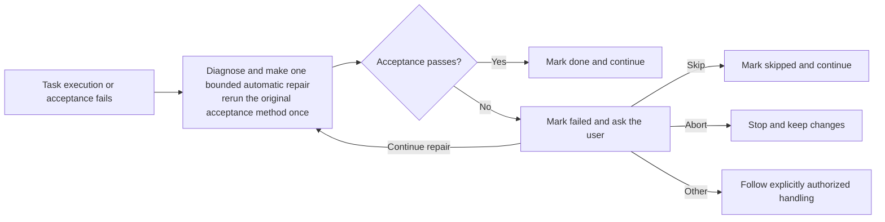

# {Feature display name} Implementation plan

> **Purpose**: translate the AC in spec.md and TC in test.md into an executable task list, consumed by `fibo-executing-plan`.
> **Location**: `.fibo/docs/specs/<feature-slug>/plan.md`

## 1. AC coverage self-review before writing to disk

| AC | TC | Covering task |
| --- | --- | --- |
| AC-XX | TC-01 | task-NN |
| AC-YY | TC-02 | task-MM |

- ✓ AC coverage NN / NN = 100%
- ✓ All AC referenced by tasks are within the spec, with no out-of-bounds references
- ✓ All TC referenced by tasks exist in test.md
- ✓ Every prod-code task references test.md §5, declares each concrete test artifact's `new` / `existing` origin plus access, and includes every artifact marked `modify` in involved-files
- ✓ Every `new` test source declares its owning `src/...` path and mirrors its directory under the sibling `test/` tree (`src/a/c` → `test/a/c`)
- ℹ Non-prod-code tasks marked "integrative" do not participate in the judgment (involved-AC / involved-TC fields are `-`)

## 2. Task list

### task-{NN}: {one-line title}

- **Description**: {what to do / why}
- **Involved AC**: AC-XX, AC-YY  (integrative tasks may fill in `-`)
- **Involved TC**: TC-01, TC-02  (non-behavioral integrative tasks may fill in `-`)
- **TDD mode**: new-behavior | regression | characterization | reuse-existing | exempt: {reason} | `-` (non-prod only)
- **Test contract**: `test.md` §5 `task-01 / TC-01` row (canonical RED / BASELINE / TARGET commands), or `-` for non-prod
- **Test artifacts**:
  - `test/a/c/Foo.test.ts` — new, modify; source `src/a/c/Foo.ts` (must also appear in involved-files)
  - `test/a/c/Existing.spec.ts` — existing, read-only (reference only; if it must change, replan it as `modify` before execution)
  - `test/fixtures/sample.json` — new, modify; shared-support: `{why no single src mapping exists}` (only when needed)
- **Involved files**:
  - `test/a/c/Foo.test.ts` (all artifacts marked modify)
  - `path/to/file` (exact)
  - `path/glob/*.ts` (glob)
- **Acceptance method**: run the referenced test.md TARGET / alternate-verification command, then `{any additional task-specific command}`; behavioral AC cannot be accepted only by `ls`, `grep`, file existence, lint, typecheck, or build success
- **Tags**: skill-doc | prod-code | config | ...
- **Status**: [×] not done / [√] done / [!] failed after automatic repair / [↷] skipped by user decision

### task-{NN+1}: {...}

- ...

## 3. Execution order

Execute in the order task-01 → task-NN. Explain inter-task dependencies (if any).

Total task count = N (dispatch subagents when ≥ 5; execute in the main context when < 5).

## 4. Failure handling

For a prod-code task, read the canonical commands from test.md §5, establish the declared RED or BASELINE state, then implement the minimum behavior, obtain targeted GREEN (or `[V] alternate-verified` for a justified exempt task), refactor, and rerun the target. On the first execution or acceptance failure, keep `[×]`, diagnose it, make exactly one focused repair attempt within the original involved-files boundary, and rerun the original method once. If it passes, mark `[√]` and continue. If it still fails, mark `[!]`, keep all changes without rollback, and pause for the user's choice: (a) make one additional bounded repair attempt, (b) mark `[↷]` and skip, (c) abort the plan, or (d) provide other explicit handling instructions. After all tasks resolve, `fibo-testing` Verify must pass or receive an explicit user waiver before `fibo-recording-diff` runs.

---
name: {Feature display name} Implementation plan

update-time: {YYYY-MM-DD HH:mm}

description: {a one-sentence description of the AC/TC coverage, TDD task scope, and execution boundary this implementation plan covers, for retrieval}

---
